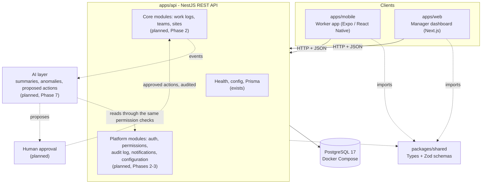

# ARCHITECTURE.md

How the Operations App is structured, and how it is intended to grow. Every section says whether it
describes something that **exists today** or something that is **planned**. As of 2026-10-12 only
the Phase 1 skeleton exists.

## System overview

Workers record their work from a phone app. Supervisors and managers monitor that work on a web
dashboard. Both clients talk to one REST API, which owns the data in PostgreSQL. A later AI layer
reads what happened and produces summaries, anomaly flags, and proposed actions that a human must
approve.

Solid arrows exist today. Dotted arrows to and from the AI layer and the planned modules do not.

## What exists today

### Apps and packages

| Path              | Package       | Responsibility                                                                                  | Today                                                                               |
| ----------------- | ------------- | ----------------------------------------------------------------------------------------------- | ----------------------------------------------------------------------------------- |
| `apps/api`        | `@ops/api`    | REST API. Owns the database, business rules, permissions, and the audit trail.                  | Config validation, Prisma client, `GET /health`. No models, no auth.                |
| `apps/web`        | `@ops/web`    | Manager dashboard for supervisors, managers, and admins.                                        | One placeholder page with an API status card.                                       |
| `apps/mobile`     | `@ops/mobile` | Worker app for iOS and Android from one codebase.                                               | One placeholder screen with an API status card.                                     |
| `packages/shared` | `@ops/shared` | Types and Zod schemas shared by the API and both clients, so the wire contract is defined once. | `healthResponseSchema` and `HealthResponse`.                                        |
| `packages/config` | `@ops/config` | Shared ESLint, Prettier, and TypeScript settings.                                               | ESLint base flat config, Prettier config, `base.json` and `library.json` tsconfigs. |

Each folder has a `memory.md` with its key files and conventions.

### Request flow that works today

1. A client reads the API base URL from its environment (`NEXT_PUBLIC_API_URL` for web,
   `EXPO_PUBLIC_API_URL` for mobile).
2. It calls `GET {apiUrl}/health`.
3. `HealthController` asks `HealthService`, which runs `SELECT 1` through `PrismaService`.
4. The API answers 200 `{ status: 'ok', database: 'up', timestamp }`, or 503 with
   `{ status: 'error', database: 'down', timestamp }`. The body shape is the same in both cases.
5. The client validates the body with `healthResponseSchema` from `@ops/shared`, whatever the HTTP
   status, and renders one of: reachable with database up, reachable with database down,
   unreachable.

This single endpoint proves the whole path: shared schema, API, database client, web, and mobile.

### Structure inside each app

- **API**: one NestJS module per concern under `apps/api/src/<concern>/`. Today: `config/`
  (environment schema and a global config module), `prisma/` (global database client), `health/`.
  The Prisma client connects lazily on the first query, so the API boots and reports its own health
  when PostgreSQL is unreachable.
- **Web**: `src/app/` holds routes and layout (presentation), `src/components/` holds UI, and
  `src/lib/` holds logic with no React in it (`lib/env.ts`, `lib/api/health.ts`).
- **Mobile**: `src/screens/` (presentation), `src/hooks/` (state), `src/api/` (HTTP calls with no
  React in them), `src/config/` (environment).

The rule in both clients: code that talks to the API or decides something lives outside components,
returns typed results instead of throwing, and is unit tested without a network.

### Configuration

One `.env` file at the repo root serves every app and Docker Compose. `.env.example` is committed
and lists every variable. Each app reads its variables in exactly one file and validates them:

| App    | File                            | Behaviour when invalid                                              |
| ------ | ------------------------------- | ------------------------------------------------------------------- |
| API    | `apps/api/src/config/env.ts`    | Exits at boot with one line per variable. Values are never printed. |
| Web    | `apps/web/src/lib/env.ts`       | Never throws; the status card shows "API not configured".           |
| Mobile | `apps/mobile/src/config/env.ts` | Does not throw. The screen shows "API not configured".              |

### Build and tooling

Turborepo runs tasks across the workspace. Every task depends on `^build`, so `@ops/shared` is
compiled before the apps that import it. The reasons for each tool and version are in
[ADR-0001](docs/decisions/0001-tech-stack.md).

## Planned architecture

Nothing in this section is built. It is the design that later phases implement, and it should be
revised by ADR when a decision changes.

### Layering

1. **The core application works without AI.** Logging work, monitoring it, permissions, and audit
   must be complete and useful with the AI layer switched off or unavailable.
2. **The AI layer sits on top and consumes events.** The core emits events (for example "work log
   created"). The AI layer subscribes to them and reads data through the same API-level services as
   any other caller.
3. **The AI layer never bypasses permissions.** Every AI read is made on behalf of a specific user
   or a specific scope and passes through the same permission checks. A summary written for a
   supervisor contains only what that supervisor is allowed to see.
4. **AI-proposed actions need human approval.** The AI layer creates proposals. A person with the
   right role approves or rejects each one. Only an approved proposal is executed, by the core
   application, not by the AI layer.
5. **Everything automated is audited.** Proposals, approvals, rejections, and executed actions are
   written to the audit log with who, what, when, and why.

### Roles and permissions (planned, Phase 3)

- Four roles: **worker**, **supervisor**, **manager**, **admin**.
- Access is decided by **role plus scope**. Scope is the set of teams and sites a user belongs to
  or is responsible for.
- Enforcement lives **in the API**. Clients hide what a user cannot do, but that is presentation
  only; the API is the authority and must reject out-of-scope requests on its own.
- Queries are filtered by scope at the data-access level, not after loading.
- The same rule applies to the AI layer (see Layering, point 3).
- Every permission rule gets tests for both the allowed and the denied case.

Intended visibility, to be confirmed in the Phase 3 ADR:

| Role       | Sees                                                  |
| ---------- | ----------------------------------------------------- |
| worker     | Their own work logs.                                  |
| supervisor | Work logs of the teams or sites they supervise.       |
| manager    | Work logs of every team and site in their scope.      |
| admin      | Everything, plus user, team, and site administration. |

### Offline-first mobile (planned, Phase 5)

Workers often have poor connectivity, so the mobile app must record work without a network.

- **Local store**: work logs and their attachments are written to on-device storage first.
- **Outbox queue**: each local change is queued and sent when the network is available.
- **Idempotent sync**: every queued change carries a client-generated identifier, so a retry after a
  lost response does not create a duplicate on the server.
- **Conflict handling**: the server detects conflicting edits and applies a documented rule. The
  rule is not chosen yet and needs an ADR.

Phase 4 builds the worker app online-only. Phase 5 adds the local store, outbox, and sync.

### Reusable Kaneri platform components (planned)

Kaneri.ai builds AI-agent and automation products. These components are intended to be shared
across Kaneri products later:

| Component     | Responsibility                                                         | Planned phase |
| ------------- | ---------------------------------------------------------------------- | ------------- |
| Configuration | Typed, validated settings from the environment.                        | Seed exists   |
| Audit log     | Append-only record of who did what, when, and through which actor.     | 2             |
| Auth          | Identity, sign-in, sessions or tokens.                                 | 3             |
| Permissions   | Role and scope checks, usable by HTTP handlers and by the AI layer.    | 3             |
| Notifications | Delivering messages to users over one or more channels.                | 6 or later    |
| AI layer      | Event consumption, provider abstraction, proposals, approval workflow. | 7             |

**Design rule that follows.** Each platform component is a self-contained module with **no
Operations-specific imports**. It must not import work logs, teams, sites, or any other domain
module of this app. Operations-specific behaviour is supplied to it through configuration or an
interface that the Operations code implements. Dependencies point one way: Operations modules may
import platform modules, never the reverse. This keeps it possible to lift a module out into its
own package with no rewrite.

Today, `apps/api/src/config/` is the only code of this kind, and it already defines the Operations
API's own variable list inside it. When configuration is extracted, the generic part (validate,
format errors, expose typed values) is what moves; the schema stays with the app.

## Constraints that apply to every phase

- TypeScript strict mode everywhere.
- No credentials or environment-specific values in code. Everything configurable is an environment
  variable listed in `.env.example`.
- Provider-specific code (storage, notifications, AI models) sits behind an interface.
- Data shapes that cross the network are defined once, in `@ops/shared`, as Zod schemas.
