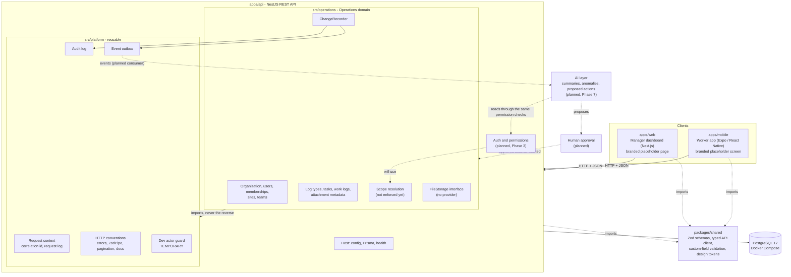
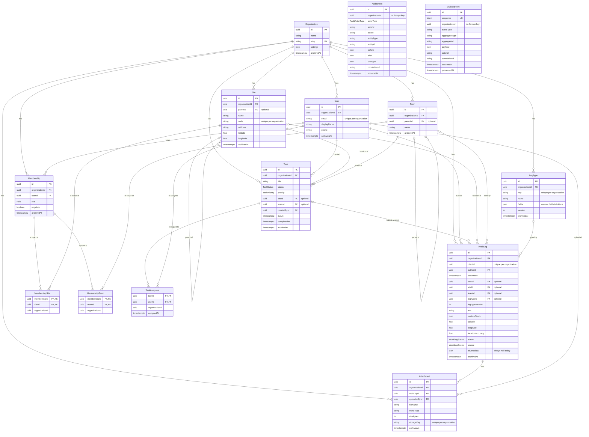

# ARCHITECTURE.md

How the system is structured, and how it is intended to grow. Every section says whether it
describes something that **exists today** or something that is **planned**. As of 2026-10-13 the
Phase 2 backend core exists: data model, REST API, audit log, event outbox, scope resolution, a
typed API client, and client branding. There is no sign-in, no permission enforcement, no feature
screens, no offline storage, and no AI layer.

## Naming

- **HZ** is the product. It belongs to the client. The name shown in the apps comes from
  configuration (`NEXT_PUBLIC_BRAND_NAME`, `EXPO_PUBLIC_BRAND_NAME`), because the same codebase may
  be deployed for other clients.
- **Kaneri.ai** builds and powers the product. Its name appears in the apps once, as a small
  "Powered by Kaneri.ai" line.
- **Operations** is the technical name and stays: the repository folder `Operations_App`, the
  package scope `@ops`, the API folder `src/operations` (the "Operations domain"), the database
  `operations_app`, and the Swagger title "Operations API". Do not rename these to a client's name.

## System overview

Workers record their work from a phone app. Supervisors and managers monitor that work on a web
dashboard. Both clients talk to one REST API, which owns the data in PostgreSQL. Every change is
written together with an audit event and a domain event. A later AI layer will read those events
and produce summaries, anomaly flags, and proposed actions that a human must approve.



Solid arrows exist today. Dotted arrows to and from the AI layer, human approval, and auth are
planned. Today the clients call only `GET /health`; the rest of the API is exercised by the tests,
Swagger, and manual requests.

## What exists today

### Apps and packages

| Path              | Package       | Responsibility                                                                                    | Today                                                                                                     |
| ----------------- | ------------- | ------------------------------------------------------------------------------------------------- | --------------------------------------------------------------------------------------------------------- |
| `apps/api`        | `@ops/api`    | REST API. Owns the database, business rules, permissions, and the audit trail.                    | 38 paths over 13 resources, audit log, outbox, scope resolution, Swagger. No sign-in, no enforcement.     |
| `apps/web`        | `@ops/web`    | Manager dashboard for supervisors, managers, and admins.                                          | One branded placeholder page with an API status card.                                                     |
| `apps/mobile`     | `@ops/mobile` | Worker app for iOS and Android from one codebase.                                                 | One branded placeholder screen with an API status card.                                                   |
| `packages/shared` | `@ops/shared` | The wire contract, defined once: schemas, the typed API client, shared validation, design tokens. | Schemas and endpoint functions for every resource, custom-field validation, health monitor, theme tokens. |
| `packages/config` | `@ops/config` | Shared ESLint, Prettier, and TypeScript settings.                                                 | ESLint base flat config, Prettier config, `strict.json`, `base.json`, and `library.json` tsconfigs.       |

Each folder has a `memory.md` with its key files and conventions.

### API layout

`apps/api/src` has three layers. Dependencies point one way: `operations` may import `platform`,
never the reverse. ESLint enforces it (`no-restricted-imports` on `src/platform/**` in
`apps/api/eslint.config.mjs`).

| Folder        | What it is                                                                                            |
| ------------- | ----------------------------------------------------------------------------------------------------- |
| `config/`     | Environment schema (`env.ts`) and the global config module. Host code.                                |
| `prisma/`     | The single Prisma client, connected lazily. Host code.                                                |
| `health/`     | `GET /health`, the only `@Public()` route.                                                            |
| `platform/`   | Reusable components with no Operations imports (see the table below).                                 |
| `operations/` | The Operations domain: one NestJS module per resource, plus `common/`, `scope/`, `storage/`, `seed/`. |
| `generated/`  | The generated Prisma client. Git-ignored; never edited.                                               |

`src/platform`:

| Folder             | Contents                                                                                                                                                                                        |
| ------------------ | ----------------------------------------------------------------------------------------------------------------------------------------------------------------------------------------------- |
| `request-context/` | `RequestContext` (AsyncLocalStorage holding the correlation id and the actor), the middleware, correlation id sanitising, the one-line request log.                                             |
| `http/`            | `ApiException`, `ApiExceptionFilter`, `ZodPipe`, `ApiDocs` (OpenAPI from Zod), pagination helpers, filter helpers (`nameFilter`, `escapeLike`, `dateRangeFilter`), `requireActor`, `@Public()`. |
| `audit/`           | `AuditService` (the only writer), snapshot, diff and redaction helpers, `AuditQueryService`, `GET /audit-events`.                                                                               |
| `outbox/`          | `OutboxService` (`publish`, `readAfter`, `markProcessed`), `OutboxQueryService`, `GET /outbox-events`.                                                                                          |
| `dev-auth/`        | **TEMPORARY.** `DevActorGuard` and `isDevAuthEnabled`. Deleted in Phase 3.                                                                                                                      |
| `docs/`            | Swagger UI and OpenAPI document setup.                                                                                                                                                          |

`PlatformModule` is global. Importing it registers the request context middleware, the exception
filter, the guard, and the two read-only controllers for the whole application. It expects the host
to provide a global `PrismaService` and a `ConfigService` answering `NODE_ENV` and
`DEV_AUTH_ENABLED`.

`src/operations`:

| Folder                                                                                                              | Contents                                                                                                                                     |
| ------------------------------------------------------------------------------------------------------------------- | -------------------------------------------------------------------------------------------------------------------------------------------- |
| `organization/`, `users/`, `memberships/`, `sites/`, `teams/`, `log-types/`, `tasks/`, `work-logs/`, `attachments/` | One module each: a controller (HTTP only), a service (rules and transactions), and a `toXxx` mapper from the database row to the wire shape. |
| `scope/`                                                                                                            | `resolveScope` (pure function), `ScopeService`, and two inspection endpoints.                                                                |
| `common/`                                                                                                           | `ChangeRecorder`, `references.ts` (`assertActiveReferences`, `assertValidParent`), `hierarchy.ts`, `db.ts` helpers.                          |
| `storage/`                                                                                                          | The `FileStorage` interface and its injection token. No implementation is bound and nothing injects it.                                      |
| `seed/`                                                                                                             | `demo-seed.ts`, the demo data, created through the real services.                                                                            |

### Data model

Defined in `apps/api/prisma/schema.prisma`, applied by two migrations in
`apps/api/prisma/migrations/`. Ids are UUID version 7 (`@default(uuid(7))`), so they sort by
creation time. Roles, statuses, priorities, sources, and the audit actor type are PostgreSQL enums.
Timestamps are `timestamptz(3)`. The reasoning is in
[ADR-0002](docs/decisions/0002-flexible-organization-and-scope-model.md) and
[ADR-0003](docs/decisions/0003-configurable-log-types-with-custom-fields.md).



Points the diagram does not show:

- **Enums**: `Role` (`worker`, `supervisor`, `manager`, `admin`); `TaskStatus` (`todo`,
  `in_progress`, `blocked`, `done`, `cancelled`); `TaskPriority` (`low`, `normal`, `high`,
  `urgent`); `WorkLogStatus` (`draft`, `submitted`, `approved`, `rejected`); `WorkLogSource`
  (`manual`, `voice`, `photo`, `ai`); `AuditActorType` (`user`, `system`). The arrays in
  `packages/shared/src/domain/enums.ts` must match them exactly, in the same order.
- **`AuditEvent` and `OutboxEvent` are platform tables.** They have no foreign keys to business
  tables and store entity ids as plain strings, so they can move to another product unchanged.
- **`AuditEvent` is append-only at the database level.** The first migration adds a trigger that
  raises an error on `UPDATE` or `DELETE` of a row. It does not block `TRUNCATE` (the integration
  test harness relies on that), so a database role allowed to truncate can still empty the log.
- **Indexes** start with `organizationId` on every business table, followed by the common filters
  (status, site, team, author, `occurredAt`, `dueAt`, `archivedAt`).
- **Foreign keys** are `ON DELETE RESTRICT`. Only the membership scope rows and task assignee rows
  cascade with their parent. Nothing is deleted through the API; records are archived.
- **Attachments are metadata only.** The bytes will live behind the `FileStorage` interface
  (Phase 4). No file can be uploaded or downloaded today.
- **`source` and `aiMetadata`** are reserved for the AI phases. `source` is always `manual` in
  practice and the API accepts only `null` for `aiMetadata`.

### Request flow

1. **Boot** (`src/main.ts`): the environment is validated before Nest starts. The `x-powered-by`
   header is disabled, the request context middleware is installed first, CORS is enabled for
   `CORS_ORIGINS`, and Swagger is mounted only when `NODE_ENV` is `development`.
2. **Request context middleware**: takes the correlation id from the `x-request-id` request header
   when it is safe (at most 64 characters, letters, digits and `. _ : -`), otherwise generates a
   UUID. It echoes the id in the `x-request-id` response header and writes one JSON log line when
   the response finishes: method, path without the query string, status, duration, correlation id,
   actor id. Bodies, headers, and query values are never logged. `/health` and `/docs*` are logged
   at debug level. The middleware runs twice on purpose: once on the HTTP adapter so that a request
   with a malformed body still gets an id, and once from `PlatformModule` after the body parser,
   to re-enter the same context.
3. **Guard**: `DevActorGuard` (global) gives every non-public request an acting user, or answers 401. See "Acting user" below.
4. **Controller**: `ZodPipe` validates the body, query, and path parameters against schemas from
   `@ops/shared`. The controller reads the actor with `requireActor()` and passes
   `organizationId` to the service. It contains no rules.
5. **Service**: runs the rules and the write inside one database transaction (next section).
6. **Errors**: `ApiExceptionFilter` (global) turns anything thrown into the standard error body.

### The write pattern

Every write in the Operations domain is **one transaction containing the business row, its audit
event, and its outbox event**:

```text
prisma.$transaction(tx =>
  load the current row (404 if missing or in another organization, 409 if archived)
  check references with assertActiveReferences (422)
  write the row
  changes.record(tx, { organizationId, entityType, verb, entityId, before, after, extra })
)
```

`ChangeRecorder` (`src/operations/common/change-recorder.ts`) is the only caller of
`AuditService.record` and `OutboxService.publish`. It writes both with the same name,
`<entityType>.<verb>`, and the same transaction client, so the three rows commit or roll back
together. A service must never write a business row outside this pattern.

- **Audit event**: actor (`user` with the id, or `system` when there is no request, as in the
  seed), action, entity type and id, `before`, `after`, `changes` (a top-level field diff,
  `{ field: { from, to } }`, null on create), correlation id, time.
- **Outbox event**: the same name as `eventType`, the entity as the aggregate, and the payload
  `{ ...extra, <entity>: after }`. The entity sits under its camelCase name (`site`, `workLog`,
  `logType`) in its wire shape, so a consumer does not need to re-read it. `extra` carries facts
  such as `{ from, to }` for a status change or `{ added, removed }` for assignees.
- **Redaction**: before storing, both replace the value of any key that looks sensitive, at any
  depth, with `"[redacted]"`. The default pattern matches key names containing `password`,
  `passphrase`, `passcode`, `secret`, `token`, `api_key`, `credential`, or `authorization`, and
  names ending in `hash`. This is by key name, so it also catches a custom field keyed `token_no`.
- **No-op writes record nothing**: archiving an archived record, restoring an active one, setting
  the status a record already has, or sending the assignee list a task already has returns the
  record unchanged with no audit or outbox row. A retried work log create (same `clientId`) also
  records nothing.

Actions and event types in use (31):

| Entity         | Verbs                                                                   |
| -------------- | ----------------------------------------------------------------------- |
| `organization` | `created` (seed only; no endpoint creates organizations), `updated`     |
| `user`         | `created`, `updated`, `archived`, `restored`                            |
| `membership`   | `created`, `updated`, `archived`                                        |
| `site`         | `created`, `updated`, `archived`, `restored`                            |
| `team`         | `created`, `updated`, `archived`, `restored`                            |
| `log_type`     | `created`, `updated`, `archived`                                        |
| `task`         | `created`, `updated`, `status_changed`, `assignees_changed`, `archived` |
| `work_log`     | `created`, `updated`, `status_changed`, `archived`                      |
| `attachment`   | `created`, `archived`                                                   |

The outbox has no consumer yet. `OutboxService.readAfter` and `markProcessed` exist for the Phase 7
consumer and are called only by tests; nothing sets `processedAt`. Sequence numbers are assigned
at insert, not at commit, so a consumer that relies on the cursor alone can miss an event from a
transaction that commits late. The Phase 7 consumer must re-read a short window or use
`processedAt`.

### API surface

38 paths. Every route except `GET /health` needs an acting user. The organization is always the
acting user's; it is never taken from the URL or the body.

| Resource     | Routes                                                                                                                                                     |
| ------------ | ---------------------------------------------------------------------------------------------------------------------------------------------------------- |
| Health       | `GET /health` (public)                                                                                                                                     |
| Organization | `GET /organization`, `PATCH /organization` (name, settings)                                                                                                |
| Users        | `GET /users`, `POST /users`, `GET /users/:id`, `PATCH /users/:id`, `POST /users/:id/archive`, `POST /users/:id/restore`                                    |
| Scope        | `GET /scope/me`, `GET /users/:id/scope` (inspection only)                                                                                                  |
| Memberships  | `GET /memberships`, `POST /memberships`, `GET /memberships/:id`, `PATCH /memberships/:id`, `POST /memberships/:id/archive`                                 |
| Sites        | `GET /sites`, `POST /sites`, `GET /sites/:id`, `PATCH /sites/:id`, `POST /sites/:id/archive`, `POST /sites/:id/restore`                                    |
| Teams        | `GET /teams`, `POST /teams`, `GET /teams/:id`, `PATCH /teams/:id`, `POST /teams/:id/archive`, `POST /teams/:id/restore`                                    |
| Log types    | `GET /log-types`, `POST /log-types`, `GET /log-types/:id`, `PATCH /log-types/:id`, `POST /log-types/:id/archive`                                           |
| Tasks        | `GET /tasks`, `POST /tasks`, `GET /tasks/:id`, `PATCH /tasks/:id`, `PATCH /tasks/:id/status`, `PUT /tasks/:id/assignees`, `POST /tasks/:id/archive`        |
| Work logs    | `GET /work-logs`, `POST /work-logs`, `GET /work-logs/:id`, `PATCH /work-logs/:id`, `PATCH /work-logs/:id/status`, `POST /work-logs/:id/archive`            |
| Attachments  | `GET /work-logs/:workLogId/attachments`, `POST /work-logs/:workLogId/attachments`, `GET /attachments/:id`, `POST /attachments/:id/archive` (metadata only) |
| Audit events | `GET /audit-events`, `GET /audit-events/:id` (read-only)                                                                                                   |
| Outbox       | `GET /outbox-events`, `GET /outbox-events/:id` (read-only; internal and testing use, not a product API)                                                    |

Only users, sites, and teams can be restored. There is no delete route anywhere.

In development the OpenAPI document is generated from the same Zod schemas that validate the
requests (`ApiDocs`), and served at `/docs` (Swagger UI), `/docs-json`, and `/docs-yaml`. Those
routes do not exist in any other environment.

### HTTP conventions

**Error body.** Every non-2xx response except `GET /health` has the shape of `apiErrorSchema` in
`@ops/shared`:

```json
{
  "statusCode": 422,
  "code": "unprocessable",
  "message": "The request refers to records that do not exist or are archived",
  "details": [
    { "path": "siteId", "message": "Site ... does not exist in this organization or is archived" }
  ],
  "correlationId": "the x-request-id of the request",
  "timestamp": "2026-10-13T10:00:00.000Z"
}
```

`code` is one of `validation_failed`, `unauthenticated`, `forbidden`, `not_found`, `conflict`,
`unprocessable`, `service_unavailable`, `internal_error`. Clients branch on `code`, never on
`message`. Unexpected errors are logged with the correlation id and answered with a generic 500.

| Status  | When                                                                                                                           |
| ------- | ------------------------------------------------------------------------------------------------------------------------------ |
| 400     | A body, query, or path parameter fails its schema. Request bodies are strict: an unknown key is a 400 with that key in `path`. |
| 401     | No acting user (see below).                                                                                                    |
| 404     | The record does not exist, or belongs to another organization. The two cases are indistinguishable on purpose.                 |
| 409     | Changing an archived record, or a unique value already in use (user email, log type key, attachment storage key).              |
| 422     | A body refers to a record that is in another organization or archived, or a parent that would create a cycle.                  |
| 200/201 | `POST /work-logs` answers 201 for a new log, and 200 with the stored log when the organization already has that `clientId`.    |

**Lists.** Every list endpoint returns `{ items, page, pageSize, total }`.

- `page` starts at 1. `pageSize` defaults to 25 and is at most 100.
- `sort=field:asc` or `sort=field:desc`, restricted to the fields each endpoint allows. `id` is
  added as a tie-breaker so pages are stable.
- Archived records are left out unless `includeArchived=true`.
- `search` is a case-insensitive "contains" on the fields the endpoint names. The term is matched
  literally: `%` and `_` are escaped.
- Date ranges are inclusive at the lower bound and exclusive at the upper bound everywhere:
  `from` / `to` on audit and outbox events, `occurredFrom` / `occurredTo` on work logs,
  `dueFrom` / `dueTo` on tasks.
- `action` (audit) and `eventType` (outbox) match exactly, or as a prefix when the value ends in a
  dot or an asterisk (`task.` and `task.*`).
- The outbox `sequence` is a 64-bit integer sent as a decimal string. `afterSequence` is the
  consumer cursor; a value that does not fit in 64 bits is a 400.

**Updates.** `PATCH` bodies are partial: a field left out is unchanged, `null` clears a nullable
field, and an empty body is a 400. Archive and restore are `POST .../archive` and
`POST .../restore` and answer 200 with the record.

### Acting user: the dev header (TEMPORARY)

There is no authentication. Until Phase 3, the acting user comes from a development-only request
header, **`x-dev-user-id`**, which holds a user id. Anyone who can reach the API with this enabled
can act as any user. It exists only so that audit records have an actor.

How it is gated, in three independent layers:

1. **Policy** (`platform/dev-auth/dev-auth.policy.ts`): the header is honoured only when
   `NODE_ENV === 'development'` **and** `DEV_AUTH_ENABLED === true` (a boolean). Anything missing,
   unknown, or oddly typed means off.
2. **Boot** (`config/env.ts`): `NODE_ENV` defaults to `production` when unset. If
   `DEV_AUTH_ENABLED` is true and `NODE_ENV` is anything but `development`, validation fails and
   the process exits before Nest starts. `NODE_ENV` is not read from `.env`; the package scripts
   set it (`dev` sets `development`, `start` sets `production`).
3. **Guard** (`platform/dev-auth/dev-actor.guard.ts`): re-evaluates the policy on its own. When
   dev auth is off, every non-public route answers 401 and the header is never read. When it is
   on, the header must be a UUID naming an existing, non-archived user; otherwise 401. The guard
   logs a warning at startup while dev auth is enabled.

As a further precaution the API listens on `127.0.0.1` in the default configuration, so it is not
reachable from the local network.

Consequence: a production build (`pnpm --filter @ops/api start`) refuses to start while `.env`
has `DEV_AUTH_ENABLED=true`, and with the flag off it answers 401 on everything except `/health`.
That is the intended state until Phase 3 replaces the `dev-auth/` folder with real sign-in.

### Scope model (resolved, not enforced)

A user's access is described by memberships: a role plus a scope (the whole organization, any
sites, any teams, as a union). `resolveScope` turns them into a `ResolvedScope`:

| Field      | Meaning                                                                                                |
| ---------- | ------------------------------------------------------------------------------------------------------ |
| `active`   | False when the user is archived; nothing else grants anything then.                                    |
| `roles`    | Distinct roles of the user's active memberships.                                                       |
| `orgWide`  | True when a supervisor, manager, or admin membership covers the whole organization.                    |
| `siteIds`  | Sites the user may see, descendants included. Every site when `orgWide`.                               |
| `teamIds`  | Teams the user may see, descendants included. Every team when `orgWide`.                               |
| `userIds`  | Users whose records the user may see, always including themselves. The literal `'all'` when `orgWide`. |
| `memberOf` | Where the user works as a worker: `{ orgWide, siteIds, teamIds }`, descendants included.               |

The rules are listed in [ADR-0002](docs/decisions/0002-flexible-organization-and-scope-model.md)
and in the comment on `resolveScope`. In short: worker memberships grant no view of other people;
supervisor, manager, and admin memberships grant the same view over their scope; memberships
combine as a union; archived memberships and archived users grant nothing; archived sites and
teams still count.

**Nothing enforces this yet.** Any acting user can read and change everything in their own
organization. The result is exposed only for inspection at `GET /scope/me` and
`GET /users/:id/scope`. `ScopeService` reads every membership, site, and team of the organization
on each call.

### Typed API client

`packages/shared/src/api-client/` is the one way the web and mobile apps call the API.

- **Transport** (`createApiTransport`): the only place that performs HTTP. It adds headers and a
  timeout (10 s by default), parses the body, validates it against the schema passed by the
  caller, and returns an `ApiResult`. Calls never throw.
- **`ApiResult<Data>`** is `{ ok: true, status, data }` or `{ ok: false, failure }`, where
  `failure.kind` is `network`, `timeout`, `invalid-response`, or `http` (the API's standard error
  body, in `failure.error`).
- **Endpoint functions**: each resource file in `src/domain/` and `src/platform/` exports an
  `xxxEndpoints(transport)` function next to its schemas. `createApiClient(options)` assembles them
  into one object: `health`, `organization`, `users`, `memberships`, `sites`, `teams`, `logTypes`,
  `tasks`, `workLogs`, `attachments`, `scope`, `auditEvents`, `outboxEvents`.
- **Headers** come from `getHeaders` in the options. That is where the dev header goes today and
  where a token will go in Phase 3. Neither app sets it yet.
- **Health monitor** (`createHealthMonitor`): framework-free. It checks `/health` and, while
  nothing answers (network error or timeout), retries after 2, 4, 8, and 16 seconds, then stops
  until a manual check. `describeHealth` maps its state to the wording both apps show.

Each app builds its client once (`apps/web/src/lib/api/client.ts`,
`apps/mobile/src/api/client.ts`) and it is `null` when the API URL is not configured. To add a
resource: write the schemas and `xxxEndpoints` in `@ops/shared`, then add it to `createApiClient`.

### Design tokens and branding

- **Tokens** live in `packages/shared/src/theme/`: colours, spacing, radii, font sizes, and font
  weights as plain constants. The palette was sampled from the client's logo (`docs/brand/`):
  background `#000000`, gold primary `#D4A454`, brand red `#D80611`. The theme is dark only.
- **Contrast is tested.** `CONTRAST_REQUIREMENTS` lists every foreground and background pairing the
  tokens are meant for, and the unit tests check each against WCAG AA. The brand red fails AA as
  normal text on black, so it is used only for decoration; text that must be red uses
  `accentText` / `danger` (`#FF6B6E`).
- **Web**: the root layout sets the tokens as CSS custom properties on `<html>`
  (`themeCssVariables`). Stylesheets use only `var(--color-...)`, `var(--space-...)`,
  `var(--radius-...)`, `var(--font-size-...)`.
- **Mobile**: screens import the token constants directly into `StyleSheet.create`.
- **Brand module**: each app has one (`apps/web/src/lib/brand.ts`,
  `apps/mobile/src/config/brand.ts`) holding the name, the app label, the logo, and the
  "Powered by Kaneri.ai" line. Components read the brand from there and never spell out a client
  name. The name falls back to "Operations" when the variable is not set.

To re-brand for another client:

1. Set `NEXT_PUBLIC_BRAND_NAME` and `EXPO_PUBLIC_BRAND_NAME`.
2. Replace the image files, keeping names and sizes: `apps/web/public/brand/logo-512.png`,
   `apps/web/src/app/icon.png`, `apps/web/src/app/apple-icon.png`, and the three files in
   `apps/mobile/assets/brand/` (`logo-512.png`, `icon-1024.png`, `adaptive-icon-foreground.png`).
3. If the colours differ, change `darkTheme` in `packages/shared/src/theme/tokens.ts` and run the
   tests; a pairing that no longer meets AA fails.
4. Restart the dev servers (the names are inlined at bundle time).

The mobile slug, scheme, and bundle identifiers in `apps/mobile/app.config.ts` are deliberately
neutral, but `ai.kaneri.operations` is hard-coded and must come from configuration before the
first store or development build.

### Structure inside the clients

- **Web**: `src/app/` holds routes and layout, `src/components/` holds UI, `src/hooks/` connects
  shared logic to React, and `src/lib/` holds logic with no React in it (`env.ts`, `brand.ts`,
  `api/client.ts`).
- **Mobile**: `src/screens/` (presentation), `src/hooks/` (state), `src/api/` (the client),
  `src/config/` (environment and brand).

The rule in both: code that talks to the API or decides something lives outside components,
returns typed results instead of throwing, and is unit tested without a network. Logic both apps
need lives in `@ops/shared`.

### Configuration

One `.env` file at the repo root serves every app and Docker Compose. `.env.example` is committed
and lists every variable. Each app reads its variables in exactly one file and validates them:

| App    | File                            | Behaviour when invalid                                                               |
| ------ | ------------------------------- | ------------------------------------------------------------------------------------ |
| API    | `apps/api/src/config/env.ts`    | Exits at boot with one line per variable. Values are never printed.                  |
| Web    | `apps/web/src/lib/env.ts`       | Never throws. The status card shows "API not configured"; the brand name falls back. |
| Mobile | `apps/mobile/src/config/env.ts` | Never throws. The screen shows "API not configured"; the brand name falls back.      |

`apps/mobile/app.config.ts` also reads `EXPO_PUBLIC_BRAND_NAME`, because it runs in Node before the
bundle exists.

### Build, tooling, and tests

Turborepo runs tasks across the workspace. Every task depends on `^build`, so `@ops/shared` is
compiled before the apps that import it. The reasons for each tool and version are in
[ADR-0001](docs/decisions/0001-tech-stack.md).

- **Unit tests** (`pnpm test`) need no database and no network.
- **Integration tests** (`pnpm test:integration`) boot the real Nest application in-process and
  call it over HTTP against a separate PostgreSQL database named by `DATABASE_URL_TEST`. They are
  not part of `pnpm test` or Turbo. A guard refuses any database whose name does not end in
  `_test` or that equals the development database, because the suite truncates every table
  between tests.

## Planned architecture

Nothing in this section is built. It is the design that later phases implement, and it should be
revised by ADR when a decision changes.

### Layering

1. **The core application works without AI.** Logging work, monitoring it, permissions, and audit
   must be complete and useful with the AI layer switched off or unavailable.
2. **The AI layer sits on top and consumes events.** The core already writes them to the outbox.
   The AI layer will read them and read data through the same API-level services as any other
   caller.
3. **The AI layer never bypasses permissions.** Every AI read is made on behalf of a specific user
   or a specific scope and passes through the same permission checks. A summary written for a
   supervisor contains only what that supervisor is allowed to see.
4. **AI-proposed actions need human approval.** The AI layer creates proposals. A person with the
   right role approves or rejects each one. Only an approved proposal is executed, by the core
   application, not by the AI layer.
5. **Everything automated is audited.** Proposals, approvals, rejections, and executed actions are
   written to the audit log with who, what, when, and why.

### Authentication and permissions (planned, Phase 3)

- Real sign-in replaces `platform/dev-auth/`. The mechanism is not chosen and needs an ADR.
- Access is decided by **role plus scope**, using the resolved scope described above.
- Enforcement lives **in the API**. Clients hide what a user cannot do, but that is presentation
  only; the API is the authority and must reject out-of-scope requests on its own.
- Queries are filtered by scope at the data-access level, not after loading.
- The same rule applies to the AI layer (see Layering, point 3).
- Every permission rule gets tests for both the allowed and the denied case.

Open design points Phase 3 must settle before wiring routes:

- **Record visibility**: how `siteIds`, `teamIds`, `userIds`, and `memberOf` combine for one
  record.
- **Per-field permissions**: request bodies currently trust the caller. Any user can set
  `authorId` to someone else, create or move a work log to `approved`, edit an approved log, and
  receive the stored log of any user in the organization by retrying its `clientId`.
- **Status transitions**: any status can be set from any status today.
- **Who may read audit and outbox events.** They hold full entity snapshots, including email,
  phone, free text, and GPS positions.
- **Caching** the resolved scope per request.

Intended visibility, to be confirmed in the Phase 3 ADR:

| Role       | Sees                                                  |
| ---------- | ----------------------------------------------------- |
| worker     | Their own work logs.                                  |
| supervisor | Work logs of the teams or sites they supervise.       |
| manager    | Work logs of every team and site in their scope.      |
| admin      | Everything, plus user, team, and site administration. |

### File storage (planned, Phase 4)

`FileStorage` (`apps/api/src/operations/storage/file-storage.ts`) assumes direct uploads: the API
hands the client a short-lived upload target, the client uploads the bytes straight to storage,
and the API then records the metadata. Before a provider is bound, the API must generate the
storage key itself (prefixed with the organization id) and stop accepting `storageKey` in the
create body; today the client supplies it.

### Offline-first mobile (planned, Phase 5)

Workers often have poor connectivity, so the mobile app must record work without a network.

- **Local store**: work logs and their attachments are written to on-device storage first.
- **Outbox queue**: each local change is queued and sent when the network is available.
- **Idempotent sync**: every queued change carries a client-generated identifier. The server side
  of this exists: `POST /work-logs` is idempotent per (organization, `clientId`).
- **Conflict handling**: the server detects conflicting edits and applies a documented rule. The
  rule is not chosen yet and needs an ADR. There is no row version or optimistic locking today;
  concurrent updates are last-write-wins and can record a stale `before` in the audit log.

Phase 4 builds the worker app online-only. Phase 5 adds the local store, outbox, and sync.

## Reusable Kaneri platform components

Kaneri.ai builds AI-agent and automation products. These components are intended to be shared
across Kaneri products later.

| Component        | Responsibility                                                          | State                                                                                 |
| ---------------- | ----------------------------------------------------------------------- | ------------------------------------------------------------------------------------- |
| Configuration    | Typed, validated settings from the environment.                         | Exists in `src/config/`, mixed with this API's own variable list.                     |
| Request context  | Correlation id, acting user, one structured log line per request.       | Exists: `src/platform/request-context/`.                                              |
| HTTP conventions | Error body, Zod validation pipe, pagination, filters, OpenAPI from Zod. | Exists: `src/platform/http/`, `src/platform/docs/`, schemas in `@ops/shared`.         |
| Audit log        | Append-only record of who did what, when, and through which actor.      | Exists: `src/platform/audit/`, table `AuditEvent`.                                    |
| Event outbox     | Domain events written in the same transaction as the change.            | Exists (write and read): `src/platform/outbox/`, table `OutboxEvent`. No consumer.    |
| File storage     | Provider-neutral interface for upload targets and download URLs.        | Interface only, in `src/operations/storage/` (no Operations imports). Phase 4.        |
| Design tokens    | Theme constants, contrast maths, CSS variables.                         | Exists: `packages/shared/src/theme/`.                                                 |
| Typed API client | Transport, result type, health monitor.                                 | Exists: `packages/shared/src/api-client/` (the resource list is Operations-specific). |
| Auth             | Identity, sign-in, sessions or tokens.                                  | Planned, Phase 3. `dev-auth/` is a temporary stand-in.                                |
| Permissions      | Role and scope checks, usable by HTTP handlers and by the AI layer.     | Planned, Phase 3. Scope resolution exists in `src/operations/scope/`.                 |
| Notifications    | Delivering messages to users over one or more channels.                 | Planned, Phase 6 or later.                                                            |
| AI layer         | Event consumption, provider abstraction, proposals, approval workflow.  | Planned, Phase 7.                                                                     |

**Design rule.** Each platform component is a self-contained module with **no Operations-specific
imports**. It must not import work logs, teams, sites, or any other domain module. Operations
behaviour is supplied through configuration or an interface that the Operations code implements.
Dependencies point one way: Operations modules may import platform modules, never the reverse.

What "self-contained" means today, and what extraction would still need:

- The platform modules write through narrow structural types (`AuditWriter`, `OutboxWriter`,
  `DevActorUserReader`), not through the Operations Prisma types, so they do not depend on the
  schema beyond their own tables.
- They do import the host's `PrismaService` (`src/prisma/`) and constants and schemas from
  `@ops/shared`. Extraction means supplying a database handle by injection and moving the
  `common/` and `platform/` parts of `@ops/shared` with them.
- `src/config/` defines this API's own variable list. When configuration is extracted, the generic
  part (validate, format errors, expose typed values) moves and the schema stays with the app.

## Constraints that apply to every phase

- TypeScript strict mode everywhere.
- No credentials or environment-specific values in code. Everything configurable is an environment
  variable listed in `.env.example`.
- Provider-specific code (storage, notifications, AI models) sits behind an interface.
- Data shapes that cross the network are defined once, in `@ops/shared`, as Zod schemas.
- Every write records an audit event and an outbox event in the same transaction, through
  `ChangeRecorder`.
- Every business record carries `organizationId`, and every query filters on the acting user's
  organization.
- No client name in code. The brand comes from configuration and each app's brand module.
