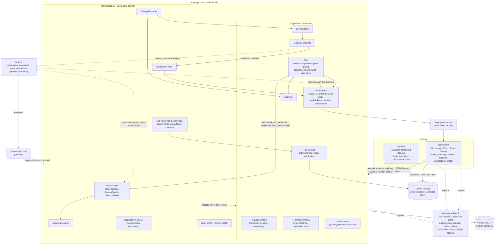
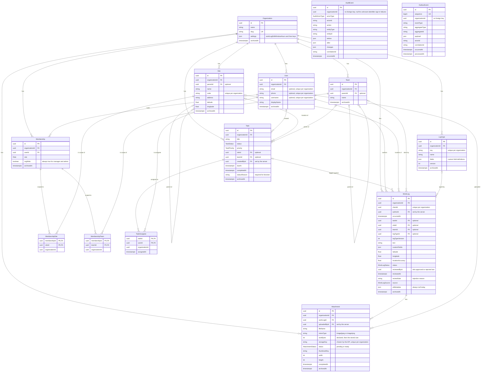
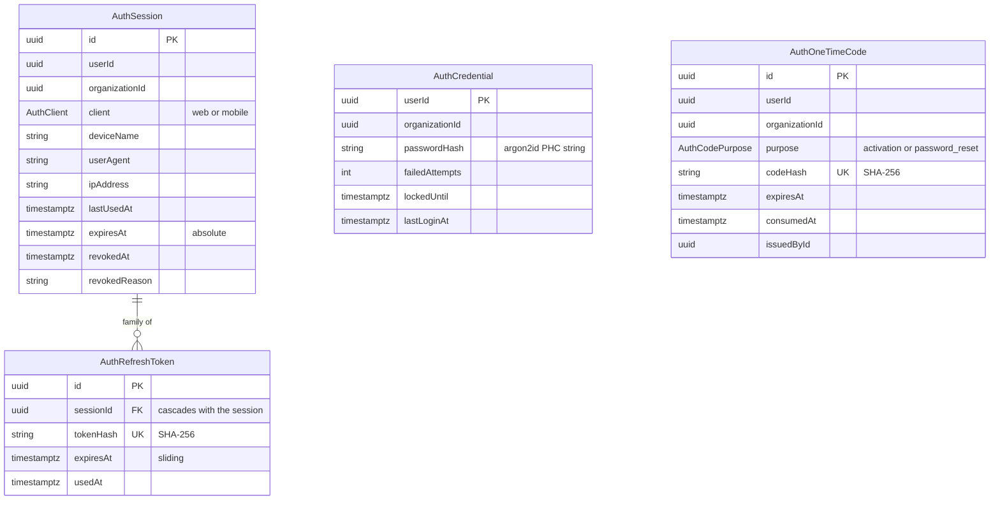
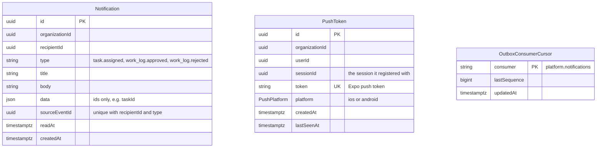

# ARCHITECTURE.md

How the system is structured, and how it is intended to grow. Every section says whether it
describes something that **exists today** or something that is **planned**. As of 2026-10-17 the
Phase 4 code exists: the Phase 2 backend core (data model, REST API, audit log, event outbox, scope
resolution, typed API client, client branding), the Phase 3 sign-in and permission enforcement on
every route, and from Phase 4 the worker app on the phone, S3-compatible photo storage with
verified uploads and signed downloads, in-app and push notifications, and the outbox consumer that
feeds them. The web app still has only its login pages. There is no offline storage and no AI
layer.

## Naming

- **HZ** is the product. It belongs to the client. The name shown in the apps comes from
  configuration (`NEXT_PUBLIC_BRAND_NAME`, `EXPO_PUBLIC_BRAND_NAME`), because the same codebase may
  be deployed for other clients.
- **Kaneri.ai** builds and powers the product. Its name appears in the apps once, as a small
  "Powered by Kaneri.ai" line.
- **Operations** is the technical name and stays: the repository folder `Operations_App`, the
  package scope `@ops`, the API folder `src/operations` (the "Operations domain"), the database
  `operations_app`, and the Swagger title "Operations API". Do not rename these to a client's name.

## System overview

Workers record their work from a phone app. Supervisors and managers monitor that work on a web
dashboard. Both clients talk to one REST API, which owns the data in PostgreSQL, authenticates
every request, and decides what each user may see and do. Every change is written together with
an audit event and a domain event. A later AI layer will read those events and produce summaries,
anomaly flags, and proposed actions that a human must approve.



Solid arrows exist today. Dotted arrows to and from the AI layer and human approval are planned.
The arrows from auth to the access layer and from the consumer to the notification rules are
injected: the platform defines a token or a registration function, the Operations domain provides
the implementation, so the import still points one way. Today the mobile app calls the worker
routes (tasks, work logs, attachments, notifications, `/auth/*`); the web app calls `/health` and
`/auth/*`; the rest is exercised by the tests, Swagger, and manual requests.

## What exists today

### Apps and packages

| Path              | Package       | Responsibility                                                                                    | Today                                                                                                                           |
| ----------------- | ------------- | ------------------------------------------------------------------------------------------------- | ------------------------------------------------------------------------------------------------------------------------------- |
| `apps/api`        | `@ops/api`    | REST API. Owns the database, business rules, sign-in, permissions, files, notifications, audit.   | 56 paths, sign-in, a policy on every route, scoped queries, photo uploads, notifications, outbox consumer, audit, Swagger.      |
| `apps/web`        | `@ops/web`    | Manager dashboard for supervisors, managers, and admins.                                          | `/login`, `/activate`, and a protected `/` showing the signed-in user, sign-out, and the API status card. Unchanged in Phase 4. |
| `apps/mobile`     | `@ops/mobile` | Worker app for iOS and Android from one codebase.                                                 | The worker screens (home, tasks, work logs with photos and location, notifications, profile), push. Not yet run on a phone.     |
| `packages/shared` | `@ops/shared` | The wire contract, defined once: schemas, the typed API client, shared validation, design tokens. | Schemas and endpoints for every resource, `/auth/*`, notifications; session manager, upload helper, custom-field forms, theme.  |
| `packages/config` | `@ops/config` | Shared ESLint, Prettier, and TypeScript settings.                                                 | ESLint base flat config, Prettier config, `strict.json`, `base.json`, and `library.json` tsconfigs. Unchanged since Phase 1.    |

Each folder has a `memory.md` with its key files and conventions.

### API layout

`apps/api/src` has three layers. Dependencies point one way: `operations` may import `platform`,
never the reverse. ESLint enforces it (`no-restricted-imports` on `src/platform/**` in
`apps/api/eslint.config.mjs`).

| Folder                   | What it is                                                                                                      |
| ------------------------ | --------------------------------------------------------------------------------------------------------------- |
| `config/`                | Environment schema (`env.ts`) and the global config module. Host code.                                          |
| `prisma/`                | The single Prisma client, connected lazily. Host code.                                                          |
| `health/`                | `GET /health` (`@Public()`).                                                                                    |
| `platform/`              | Reusable components with no Operations imports (see the table below).                                           |
| `operations/`            | The Operations domain: one module per resource, plus `access/`, `common/`, `scope/`, `notifications/`, `seed/`. |
| `route-policies.spec.ts` | The "no route without a policy" test (boots the real modules with a fake database).                             |
| `generated/`             | The generated Prisma client. Git-ignored; never edited.                                                         |

`src/platform`:

| Folder             | Contents                                                                                                                                                                                                                                                              |
| ------------------ | --------------------------------------------------------------------------------------------------------------------------------------------------------------------------------------------------------------------------------------------------------------------- |
| `request-context/` | `RequestContext` (AsyncLocalStorage holding the correlation id and the actor `{ userId, organizationId, sessionId? }`), the middleware, correlation id sanitising, the one-line request log.                                                                          |
| `http/`            | `ApiException` (including `rateLimited`, 429 with `Retry-After`), `ApiExceptionFilter`, `ZodPipe`, `ApiDocs`, pagination and filter helpers, `requireActor`, `@Public()`.                                                                                             |
| `auth/`            | `AuthGuard`, `AuthController` (`/auth/*`), `AuthService`, `AuthAdminService` (the contract business modules call), sessions, access tokens, CSRF, one-time codes, password hashing and policy, identifiers, rate limiter, settings, `AUTH_PROFILE_PROVIDER`.          |
| `authz/`           | `@Policy(name)`, `@Authenticated()`, `@DevelopmentOnly()`, and the `REQUEST_AUTHORIZER` / `RequestAuthorizer` seam. Names only: what a policy means is decided by the host.                                                                                           |
| `storage/`         | `FileStorage` interface and `FILE_STORAGE` token, `S3FileStorage` (two S3 clients: internal and signer), `images.ts` (verify, re-encode, thumbnail; `ImageProcessor`), `concurrency.ts`, `storage-settings.ts`, the global `StorageModule`. ADR-0006.                 |
| `notifications/`   | `NotificationChannel` interface, `NotificationService` (`notify`, `notifyInTransaction`, `deliver`), the in-app list and `/notifications` routes, `PushTokenService`, `ExpoPushClient`, `ExpoPushChannel`; plus the Phase 3 `NotificationSender` for codes. ADR-0007. |
| `audit/`           | `AuditService` (the only writer), snapshot, diff and redaction helpers, `AuditQueryService`, `GET /audit-events` (`audit.read`).                                                                                                                                      |
| `outbox/`          | `OutboxService` (`publish`, `readAfter`, `markProcessed`), `OutboxQueryService`, `GET /outbox-events` (`outbox.read`, `@DevelopmentOnly()`), and the `OutboxConsumer` with its pure bookkeeping (`outbox-consumer-state.ts`). ADR-0007.                               |
| `docs/`            | Swagger UI and OpenAPI document setup, with a bearer scheme and the access cookie documented.                                                                                                                                                                         |

`PlatformModule` is global. Importing it registers, for the whole application, the request context
middleware, a `Cache-Control: no-store` middleware on `/auth/*`, the exception filter, `AuthGuard`
as the one `APP_GUARD`, the auth, audit, and outbox controllers, and the global `StorageModule` and
`NotificationsModule` (with the `/notifications` controller). It expects the host to provide a
global `PrismaService` (with the auth tables, `auditEvent`, `outboxEvent`, `notification`,
`pushToken`, and `outboxConsumerCursor`) and a `ConfigService` answering the keys listed in
`auth/auth-settings.ts` and `storage/storage-settings.ts` plus `PUSH_ENABLED`,
`EXPO_ACCESS_TOKEN`, `OUTBOX_CONSUMER_ENABLED`, and `OUTBOX_POLL_INTERVAL_MS`, and optionally, from
a global module, `REQUEST_AUTHORIZER` (without it every `@Policy` route is refused) and
`AUTH_PROFILE_PROVIDER` (without it users are described with no roles). Replaceable by providing
another value under the token: `NOTIFICATION_SENDER`, `RATE_LIMITER`, `AUTH_CLOCK`, `AUTH_RANDOM`,
`FILE_STORAGE` (the integration tests bind an in-memory fake), `NOTIFICATION_CHANNELS`,
`EXPO_PUSH_CLIENT`, `OUTBOX_CONSUMER_OPTIONS`, `EXPO_PUSH_CHANNEL_OPTIONS`. The notification and
consumer switches are on only when the configured value is exactly `true`; the API's environment
schema defaults both to `true`, a test configuration that omits them leaves them off.

`src/operations`:

| Folder                                                                                                              | Contents                                                                                                                                                                                     |
| ------------------------------------------------------------------------------------------------------------------- | -------------------------------------------------------------------------------------------------------------------------------------------------------------------------------------------- |
| `organization/`, `users/`, `memberships/`, `sites/`, `teams/`, `log-types/`, `tasks/`, `work-logs/`, `attachments/` | One module each: a controller (HTTP and `@Policy` only), a service (access rules, transactions), and mappers from the row to the wire shape(s).                                              |
| `access/`                                                                                                           | The authorization layer (global `AccessModule`): `policies.ts` (the registry), `AccessService`, `access-context.ts`, `decision.ts`, `visibility.ts`, `rules/`, the two seam implementations. |
| `scope/`                                                                                                            | `resolveScope` (pure function), `ScopeService`, `GET /scope/me` and `GET /users/:id/scope`.                                                                                                  |
| `common/`                                                                                                           | `ChangeRecorder`, `references.ts` (`assertActiveReferences`, `assertValidParent`), `hierarchy.ts`, `db.ts` helpers.                                                                          |
| `memberships/admin-guard.ts`                                                                                        | `assertAdminRemains`: the last-admin check under a per-organization advisory lock.                                                                                                           |
| `attachments/`                                                                                                      | The upload flow (`attachments.service.ts`: start, renew, complete, archive, signed URLs) and `attachment-cleanup.service.ts` (hourly expiry and purge). ADR-0006.                            |
| `notifications/`                                                                                                    | Which events notify whom (`notification-rules.ts`, pure), the English text catalogue (`notification-messages.ts`), and the service that registers the outbox handlers. ADR-0007.             |
| `seed/`                                                                                                             | `demo-seed.ts`: the demo data, created through the real services; `DEV_PASSWORDS`.                                                                                                           |

### Data model

Defined in `apps/api/prisma/schema.prisma`, applied by four migrations in
`apps/api/prisma/migrations/` (`20261013112952_init`,
`20261013150000_attachment_storage_key_per_org`, `20261014090000_auth`,
`20261017090000_phase4_mobile`). Ids are UUID version 7
(`@default(uuid(7))`), so they sort by creation time. Roles, statuses, priorities, sources, the
audit actor type, and the auth enums are PostgreSQL enums. Timestamps are `timestamptz(3)`. The
reasoning is in [ADR-0002](docs/decisions/0002-flexible-organization-and-scope-model.md),
[ADR-0003](docs/decisions/0003-configurable-log-types-with-custom-fields.md), and
[ADR-0004](docs/decisions/0004-authentication.md).



The authentication tables are platform tables with **no foreign keys to business tables** (they
store `userId` and `organizationId` as plain ids) and hold hashes only:



The Phase 4 notification tables are platform tables too, with no foreign keys to business tables:



Points the diagrams do not show:

- **Enums**: `Role` (`worker`, `supervisor`, `manager`, `admin`); `TaskStatus` (`todo`,
  `in_progress`, `blocked`, `done`, `cancelled`); `TaskPriority` (`low`, `normal`, `high`,
  `urgent`); `WorkLogStatus` (`draft`, `submitted`, `approved`, `rejected`); `WorkLogSource`
  (`manual`, `voice`, `photo`, `ai`); `AttachmentStatus` (`pending`, `ready`); `PushPlatform`
  (`ios`, `android`); `AuditActorType` (`user`, `system`); `AuthCodePurpose`; `AuthClient`. The
  business enum arrays in `packages/shared/src/domain/enums.ts`, `ATTACHMENT_STATUSES` in
  `domain/attachments.ts`, and `PUSH_PLATFORMS` in `platform/notifications.ts` must match the
  Prisma enums exactly, in the same order.
- **A user has at least one login identifier** (email, phone, or username), enforced by the API.
  Identifiers are stored normalised (email and username lower-case; phone as digits with an
  optional leading `+`). A user without an `AuthCredential` row has not been activated and cannot
  sign in.
- **`AuditEvent`, `OutboxEvent`, the `Auth*` tables, `Notification`, `PushToken`, and
  `OutboxConsumerCursor` are platform tables.** They store entity ids as plain strings, so they can
  move to another product unchanged.
- **`AuditEvent` is append-only at the database level.** The first migration adds a trigger that
  raises an error on `UPDATE` or `DELETE` of a row. It does not block `TRUNCATE` (the integration
  test harness relies on that), so a database role allowed to truncate can still empty the log.
- **Indexes** start with `organizationId` on every business table, followed by the common filters.
- **Foreign keys** are `ON DELETE RESTRICT`. Only the membership scope rows, task assignee rows,
  and refresh tokens cascade with their parent. Nothing is deleted through the API; records are
  archived.
- **Attachment bytes live in object storage**, behind `FileStorage` (see File storage below). The
  row holds the API-chosen key of the verified copy and of its thumbnail, never a URL.
- **`Task.statusReason`** is set from the `reason` of a status change (required for `blocked`) and
  cleared by a change without one. **`WorkLog.reviewedById`, `reviewedAt`, `reviewNote`** are set
  when a reviewer approves or rejects and cleared when the log goes back to `submitted` or
  `draft`; the API returns them as `review: { reviewedById, reviewedAt, note } | null`.
- **`source` and `aiMetadata`** are reserved for the AI phases. `source` is always `manual` in
  practice and the API accepts only `null` for `aiMetadata`.

### Request flow

1. **Boot** (`src/main.ts`): the environment is validated before Nest starts (one line per bad
   variable, values never printed; see Configuration). `x-powered-by` is disabled; when
   `TRUST_PROXY_HOPS` is above 0, Express trusts exactly that many proxies for the client address.
   The request context middleware is installed first. CORS allows only `CORS_ORIGINS`, with
   credentials, the headers `Content-Type`, `Accept`, `Authorization`, `x-csrf-token`, and
   `x-request-id`, and exposes `x-request-id` and `Retry-After`. Swagger is mounted only when
   `NODE_ENV` is `development`.
2. **Request context middleware**: takes the correlation id from `x-request-id` when it is safe
   (at most 64 characters, letters, digits and `. _ : -`), otherwise generates a UUID, echoes it,
   and writes one JSON log line when the response finishes (method, path without the query string,
   status, duration, correlation id, actor id). Bodies, headers, cookies, and query values are
   never logged; the push token in `DELETE /notifications/push-tokens/<token>` is replaced by
   `:token` (any letter case). `/health` and `/docs*` are logged at debug level. It runs twice on purpose: on the
   HTTP adapter (so a request with a malformed body still gets an id) and from `PlatformModule`
   after the body parser.
3. **`AuthGuard`**, the one global guard (see Authentication): development-only routes answer 404
   outside development and test; `@Public()` routes pass; otherwise the request is authenticated
   against the database, CSRF is checked for cookie sessions, the actor is put in
   `RequestContext`, and the route's policy is applied through the `RequestAuthorizer`
   (see Authorization).
4. **Controller**: `ZodPipe` validates the body, query, and path parameters against schemas from
   `@ops/shared` (400). The controller calls one service method. It contains no rules and no role
   checks.
5. **Service**: gets the caller with `AccessService.context()` (cached for the request), applies
   the pure access rules and visibility filters (404, 403, 422), and runs the write inside one
   transaction (409 for state conflicts).
6. **Errors**: `ApiExceptionFilter` (global) turns anything thrown into the standard error body
   and sets `Retry-After` for 429.

### Authentication

Reusable platform module `src/platform/auth/`. The decision, its tradeoffs, and how SSO would plug
in are in [ADR-0004](docs/decisions/0004-authentication.md).

**The guard's order of checks** (`auth.guard.ts`), for every HTTP request:

1. A route or controller marked `@DevelopmentOnly()` answers 404 (the same body as an unknown
   route) unless `NODE_ENV` is `development` or `test`, before anything else and for everyone.
2. `@Public()` routes pass with no actor.
3. **Authenticate.** The access token comes from `Authorization: Bearer`; only when the request has
   no `Authorization` header at all, from the `access_token` cookie (an unusable header never falls
   back to the cookie). The JWT must verify (HS256, fixed header, `iss`, `aud`, `exp`, `iat`). Then
   the database is asked: the session exists, is not revoked or expired, and matches the token's
   user and organization; a `web` session is accepted only from the cookie and a `mobile` session
   only from the header; the user exists, is in that organization, and is not archived. Any
   failure is 401 "Sign in to continue".
4. **CSRF**, for cookie-authenticated requests that are not `GET`, `HEAD`, or `OPTIONS`: `Origin`
   must be one of `CORS_ORIGINS` (missing or `null` refused) and `x-csrf-token` must be the
   session's token. Otherwise 403.
5. The actor `{ userId, organizationId, sessionId }` is set in `RequestContext`.
6. **Policy.** No declaration: 403, logged as a programming error. `@Authenticated()`: pass. Any
   other name: `RequestAuthorizer.authorize({ policy, actor })` from the host (missing: 403).

**Endpoints** (`auth.controller.ts`; every answer carries `Cache-Control: no-store`):

| Route                        | Access        | What it does                                                                                                                                        |
| ---------------------------- | ------------- | --------------------------------------------------------------------------------------------------------------------------------------------------- |
| `POST /auth/login`           | public        | `{ identifier, password, client: 'web' \| 'mobile', organizationSlug?, deviceName? }`. Web: cookies, `tokens: null`, `csrfToken`. Mobile: `tokens`. |
| `POST /auth/refresh`         | public        | Mobile sends `refreshToken` in the body, web an empty body (cookie). Rotates the refresh token.                                                     |
| `GET /auth/me`               | authenticated | The signed-in user (with organization name, roles, highest role), the session, and the CSRF token again for web.                                    |
| `POST /auth/logout`          | public        | Always 204. Ends the session named by the access token (an expired one is accepted) or by the refresh token (cookie or body); clears cookies.       |
| `POST /auth/logout-all`      | authenticated | Ends every session of the user, this one included.                                                                                                  |
| `GET /auth/sessions`         | authenticated | The user's own active sessions (devices), never a token.                                                                                            |
| `DELETE /auth/sessions/:id`  | authenticated | Ends one of the user's own sessions; another user's id is 404.                                                                                      |
| `POST /auth/set-password`    | public        | `{ code, password }`: activation and reset. Ends every session of the user. Bad code 422; weak password 400 (code not used up).                     |
| `POST /auth/change-password` | authenticated | `{ currentPassword, newPassword }`. Wrong current password is 400 (not 401). Ends the other sessions.                                               |

**Sessions and tokens.** Access token: JWT, 15 minutes, claims `sub`, `org`, `sid`. Refresh token:
256 random bits stored as SHA-256, single use (conditional update), sliding 30 days, never beyond
the session's absolute 90 days. A used token presented again within
`AUTH_REFRESH_REUSE_GRACE_SECONDS` (10) is a lost race (401, nothing revoked); later it is reuse:
the session is revoked and `auth.refresh_reuse_detected` is audited.

**Cookies versus bearer.** Web: `access_token` (`Path=/`) and `refresh_token` (`Path=/auth`),
`HttpOnly; SameSite=Lax`, `Secure` outside development and test, `Domain` only with
`AUTH_COOKIE_DOMAIN`; no tokens in the body. Mobile: tokens in the body, no cookies, sent back as
`Authorization: Bearer`.

**CSRF.** The token is `base64url(HMAC-SHA256(key derived from the secret, sessionId))`: bound to
the session, stored nowhere, stable across refreshes. Login (web), refresh (cookie), set-password,
and logout rely on the Origin check alone (reasons in ADR-0004).

**One-time codes.** 80 bits, `XXXX-XXXX-XXXX-XXXX`, stored as SHA-256, single use; activation 72
hours, reset 60 minutes; a new code cancels older unused codes of the same purpose. Admins issue
them with `POST /users` (activation, returned as `activation`), `POST /users/:id/activation-code`,
and `POST /users/:id/password-reset`. The code and link (`WEB_APP_URL/activate?code=...`) are in
the response and in the log **in development only**.

**Rate limiting and lockout.** `RateLimiter` interface, in-memory per process (`RATE_LIMITER`):
login 20/min per IP and 10/5 min per identifier; refresh 120/min per IP and 10/min per token;
set-password 10/min per IP and 5/10 min per code; change-password 5/5 min per user. Over the
limit: 429 `rate_limited` with `Retry-After`. Lockout after 5 consecutive failures for 15 minutes,
stored on `AuthCredential`; attempts during a lock neither count nor extend it, and concurrent
failures cannot clear it. Every failed sign-in answers the same 401 "The sign-in details are not
correct".

**Notification sender.** `NotificationSender.sendOneTimeCode(...)` in `src/platform/notifications/`.
The bound implementation, `LoggingNotificationSender`, logs that a code was issued (by user id),
the code and link only in development, and warns elsewhere that nothing was delivered.

**Security audit events** (entity type `auth`, through `AuditService`, never in the outbox):
`auth.login_succeeded`, `auth.login_failed` (with reason), `auth.locked_out`, `auth.logout`,
`auth.logout_all`, `auth.session_revoked`, `auth.refresh_reuse_detected`, `auth.code_issued`,
`auth.activated`, `auth.password_reset`, `auth.password_changed`. A failure for an unknown
identifier has no organization and only a keyed fingerprint of what was typed. Device push tokens
add `push_token.registered` and `push_token.removed` (entity type `push_token`, see
Notifications).

**Session-end hook.** `SessionService.onSessionsEnded(listener)` runs a listener inside every
transaction that ends sessions (logout, logout everywhere, ending one session, refresh reuse,
password change or reset, archiving, membership reduction). The notifications module uses it to
remove the push tokens of those sessions in the same commit.

**The seams.** Business modules use only `RequestContext.actor()` and `AuthAdminService`
(`issueOneTimeCode`, `revokeUserSessions`, `setPasswordForSeed`, `isActivated`,
`activatedUserIds`), always inside their own transaction. The Operations domain provides
`AUTH_PROFILE_PROVIDER` (organization name and roles of a user) and `REQUEST_AUTHORIZER`.

### Authorization

The model, the reasoning, and the documented limits are in
[ADR-0005](docs/decisions/0005-authorization-model.md). It lives in `src/operations/access/`.

- **Policy registry** (`policies.ts`): every policy name with the roles that may use such a route
  at all. `listPolicies()` returns it. Unknown name: 403 (fail closed).
- **`OperationsRequestAuthorizer`**: the function-level check the guard calls. A non-production
  policy (`outbox.read`) answers 404 in production before the role check; otherwise the caller
  must hold one of the policy's roles (403). It resolves the access context, which stays cached
  for the services.
- **`AccessService.context()`**: the caller's `AccessContext` (user, organization, roles highest
  first, `highestRole`, `isAdmin`, `isManagerOrAbove`, `isSupervisorOrAbove`, resolved scope),
  resolved once per request from `ScopeService` and cached on the request's context store. No
  actor, or an archived or missing user: 401. `runAsSystem(organizationId, work)` gives code
  outside a request (the seed) an admin context that is nobody's author; it throws inside a
  request.
- **Pure rules** (`rules/work-log.rules.ts`, `task.rules.ts`, `user.rules.ts`, `place.rules.ts`,
  `membership.rules.ts`, `attachment.rules.ts`, `organization.rules.ts`): plain data in, a
  `Decision` out (`allowed`, `not_found`, `forbidden`, `conflict`). `enforce()` (`decision.ts`) is
  the only place a decision becomes 404, 403, or 409.
- **`visibility.ts`**: each resource's visibility is one `Visibility` value; `isVisible()` reads it
  for one record and `visibilityWhere()` turns the same value into a Prisma `where` fragment. The
  list filter and the detail check cannot disagree.
- **404 versus 403**: 404 when the record is missing, in another organization, or outside the
  caller's visibility; 403 when it is visible but the action is not allowed, or the role may not
  use the route; 409 when the state forbids it for everyone; 422 for a bad or invisible reference
  in a body. Order: 401 / CSRF 403 / route 403 (guard), 400 (pipe), then 404, 403, 409 (service).
  A work-log status move that does not exist is 409 for anyone who can see the log.
- **Role-shaped responses**: users as `profile: basic | contact | full`; the organization as
  `view: summary | full`; tasks name people by id.

#### Permissions matrix

As implemented on 2026-10-17 in `policies.ts` and `rules/`, and checked cell by cell by
`apps/api/test/permissions-matrix.int-spec.ts`. "Their people" means the users of a supervisor's
scope (`userIds`). "Colleagues" means everyone who works at a site or team the user works at
(descendants included) and the supervisors of that place. "Task peers" means co-assignees and
creators of the user's non-archived tasks. A user with no active membership gets 403 on every
`@Policy` route; `/auth/*` and `/scope/me` still work for them.

| Resource / action                        | Worker                                                                                               | Supervisor                                                                                                                 | Manager                | Admin                                                     |
| ---------------------------------------- | ---------------------------------------------------------------------------------------------------- | -------------------------------------------------------------------------------------------------------------------------- | ---------------------- | --------------------------------------------------------- |
| Organization read                        | `summary`                                                                                            | `summary`                                                                                                                  | `summary`              | `full`                                                    |
| Organization update                      | 403                                                                                                  | 403                                                                                                                        | 403                    | yes                                                       |
| Users list / get                         | self `full`; `basic` for colleagues and task peers; others 404                                       | self `full`; `contact` for their people; `basic` for colleagues and task peers; others 404                                 | `contact` for everyone | `full` for everyone                                       |
| Users update                             | own `displayName` only (403 otherwise)                                                               | same                                                                                                                       | same                   | any field of anyone                                       |
| Users create, archive, restore, codes    | 403                                                                                                  | 403                                                                                                                        | 403                    | yes (last admin: 409)                                     |
| `GET /scope/me` / `GET /users/:id/scope` | yes / 403                                                                                            | yes / 403                                                                                                                  | yes / 403              | yes / yes                                                 |
| Memberships read / manage                | 403                                                                                                  | 403                                                                                                                        | 403                    | yes (no escalation; last admin: 409)                      |
| Sites and teams read                     | where they work (descendants included) and places of their assigned tasks; others 404                | their scope, where they work, and places of their tasks; others 404                                                        | all                    | all                                                       |
| Sites and teams manage                   | 403                                                                                                  | 403                                                                                                                        | yes                    | yes                                                       |
| Log types read / manage                  | read / 403                                                                                           | read / 403                                                                                                                 | yes / yes              | yes / yes                                                 |
| Tasks read                               | assigned to them; others 404                                                                         | in their scope, assigned to their people, created by them, or assigned to them; others 404                                 | all                    | all                                                       |
| Tasks create, edit, assign, archive      | 403                                                                                                  | site or team in scope (else 403); references visible (else 422); assignees among their people (else 422)                   | all                    | all                                                       |
| Tasks change status                      | when assigned: `todo`, `in_progress`, `blocked`, `done`; not `cancelled`; not a cancelled task (403) | any status on tasks they manage; otherwise the worker rule                                                                 | any                    | any                                                       |
| Tasks status reason                      | `blocked` needs a `reason` (400 without); the same status with a new reason updates it               | same                                                                                                                       | same                   | same                                                      |
| Work logs read                           | own; others 404                                                                                      | own, in their scope, and their people's; others 404                                                                        | all                    | all                                                       |
| Work logs create                         | own, `draft` or `submitted`, references visible (else 422)                                           | same                                                                                                                       | same                   | same                                                      |
| Work logs edit content                   | author only, within the edit window (edge inclusive), not `approved`                                 | same; never someone else's (403)                                                                                           | same                   | same                                                      |
| Work logs change status                  | author: `draft`↔`submitted`, `rejected`→`submitted`, under the edit rule                             | also review logs they can see: `submitted`→`approved`/`rejected`, `approved`/`rejected`→`submitted`; never their own (403) | same as supervisor     | same as supervisor                                        |
| Work logs review note                    | not a reviewer: cannot approve or reject (403)                                                       | `rejected` needs a `note` (400); may repeat the decision to correct the note                                               | same as supervisor     | same as supervisor                                        |
| Work logs archive                        | author under the edit rule                                                                           | author under the edit rule, or as reviewer (not their own)                                                                 | same as supervisor     | same as supervisor                                        |
| Attachments read                         | `ready` ones of logs they can see; `pending` ones only if they uploaded them (others 404)            | same                                                                                                                       | same                   | same                                                      |
| Attachments upload / renew / complete    | the parent log's archive rule (author within the edit window, not approved)                          | same, or as reviewer of a log they can see (not their own)                                                                 | same as supervisor     | same as supervisor                                        |
| Attachments archive                      | the parent log's archive rule                                                                        | same                                                                                                                       | same                   | same                                                      |
| Notifications and push tokens            | own only (`@Authenticated`); another user's notification or token 404                                | same                                                                                                                       | same                   | same                                                      |
| Audit events                             | 403                                                                                                  | 403                                                                                                                        | 403                    | yes, own organization                                     |
| Outbox events                            | 403                                                                                                  | 403                                                                                                                        | 403                    | development and test only; 404 for everyone in production |

The Phase 4 rows (task status reason, review note, pending attachments, upload renew and
complete, notifications) are covered by the `tasks`, `work-logs`, `uploads`, `worker-app`, and
`notifications` suites rather than by the matrix suite, which covers starting an upload and
reading a ready attachment.

The edit window is `organization.settings.workLogEditWindowHours` (default 24), counted from the
log's `createdAt`. A move not listed for work-log status is 409. An organization-wide supervisor
sees and manages like a manager for tasks and work logs, but still may not manage sites, teams,
log types, users, or memberships.

### The write pattern

Every write in the Operations domain is **one transaction containing the business row, its audit
event, and its outbox event**:

```text
context = await access.context()             // who is asking (401 if nobody)
prisma.$transaction(tx =>
  load the row through the caller's visibility (404 if missing, other organization, or invisible)
  enforce(rule(context, facts, ...))         // 403 visible but not allowed, 409 impossible move
  reject archived rows (409)
  check references with assertActiveReferences, through the caller's visibility (422)
  write the row (author fields from the context, never from the body)
  changes.record(tx, { organizationId, entityType, verb, entityId, before, after, extra })
  revoke sessions through AuthAdminService when access was taken away
)
```

`ChangeRecorder` (`src/operations/common/change-recorder.ts`) is the only caller of
`AuditService.record` and `OutboxService.publish` in the domain. It writes both with the same name,
`<entityType>.<verb>`, and the same transaction client, so the rows commit or roll back together.
A service must never write a business row outside this pattern. (The auth module writes its own
security events through `AuditService` directly, in its own transactions, and never to the outbox.
The seed back-dates work log `createdAt` with a direct update, outside the pattern, on purpose.)

- **Audit event**: actor (`user` with the id, or `system` when there is no request, as in the
  seed), action, entity type and id, `before`, `after`, `changes` (a top-level field diff), correlation
  id, time. A user's stored record holds nothing from the auth tables.
- **Outbox event**: the same name as `eventType`, the entity as the aggregate, and the payload
  `{ ...extra, <entity>: after }`.
- **Redaction**: before storing, both replace the value of any key that looks sensitive, at any
  depth, with `"[redacted]"`: key names containing `password`, `passphrase`, `passcode`, `secret`,
  `token`, `api_key`, `credential`, or `authorization`, and names ending in `hash`. This still
  applies in Phase 3; the auth module additionally never puts a password, code, or token in a
  payload, and the `secrets` integration suite checks logs, audit, and outbox.
- **No-op writes record nothing**: archiving an archived record, restoring an active one, the same
  status (with the same task reason or review note), the same assignees, completing a ready
  attachment, or a retried work log create (same `clientId`, same author).
- **Status payloads** carry what the notification rules need: `task.status_changed` has
  `{ from, to, reason, changedById, createdById, assigneeIds, task }`; `work_log.status_changed`
  has `{ from, to, note, changedById, authorId, reviewedById, workLog }`.
- **Outside a request** the attachment cleanup still uses the pattern, with actor `system`.
  `Notification` and `PushToken` rows are platform data, not business rows: the notifications
  module writes them itself (push token changes are audited directly through `AuditService`;
  notification rows are not audited).

Domain actions and event types (33):

| Entity         | Verbs                                                                   |
| -------------- | ----------------------------------------------------------------------- |
| `organization` | `created` (seed only; no endpoint creates organizations), `updated`     |
| `user`         | `created`, `updated`, `archived`, `restored`                            |
| `membership`   | `created`, `updated`, `archived`                                        |
| `site`         | `created`, `updated`, `archived`, `restored`                            |
| `team`         | `created`, `updated`, `archived`, `restored`                            |
| `log_type`     | `created`, `updated`, `archived`                                        |
| `task`         | `created`, `updated`, `status_changed`, `assignees_changed`, `archived` |
| `work_log`     | `created`, `updated`, `status_changed`, `archived`                      |
| `attachment`   | `upload_started`, `completed`, `archived`, `upload_expired` (system)    |

Plus the eleven `auth.*` audit actions listed under Authentication and `push_token.registered` and
`push_token.removed` (audit only).

The outbox has one consumer since Phase 4, `platform.notifications` (see Notifications). Sequence
numbers are still assigned at insert, not at commit; the consumer's 60-second settle rule is what
keeps it from missing a late-committing event.

### API surface

56 paths (49 in Phase 3, plus two attachment paths and five notification paths). Every route
declares `@Public()`, `@Authenticated()`, or `@Policy(...)`; the policy is
shown in brackets. The organization is always the caller's; it is never taken from the URL or the
body.

| Resource      | Routes                                                                                                                                                                                                                                                                                            |
| ------------- | ------------------------------------------------------------------------------------------------------------------------------------------------------------------------------------------------------------------------------------------------------------------------------------------------- |
| Health        | `GET /health` (public)                                                                                                                                                                                                                                                                            |
| Auth          | the nine `/auth/*` routes above                                                                                                                                                                                                                                                                   |
| Organization  | `GET /organization` [`organization.read`], `PATCH /organization` [`organization.update`]                                                                                                                                                                                                          |
| Users         | `GET /users`, `GET /users/:id` [`user.read`]; `PATCH /users/:id` [`user.update`]; `POST /users`, `POST /users/:id/archive`, `POST /users/:id/restore`, `POST /users/:id/activation-code`, `POST /users/:id/password-reset` [`user.manage`]                                                        |
| Scope         | `GET /scope/me` (authenticated), `GET /users/:id/scope` [`user.read_scope`]                                                                                                                                                                                                                       |
| Memberships   | `GET /memberships`, `GET /memberships/:id` [`membership.read`]; `POST /memberships`, `PATCH /memberships/:id`, `POST /memberships/:id/archive` [`membership.manage`]                                                                                                                              |
| Sites         | `GET /sites`, `GET /sites/:id` [`site.read`]; `POST`, `PATCH /:id`, `POST /:id/archive`, `POST /:id/restore` [`site.manage`]                                                                                                                                                                      |
| Teams         | `GET /teams`, `GET /teams/:id` [`team.read`]; `POST`, `PATCH /:id`, `POST /:id/archive`, `POST /:id/restore` [`team.manage`]                                                                                                                                                                      |
| Log types     | `GET /log-types`, `GET /log-types/:id` [`log_type.read`]; `POST`, `PATCH /:id`, `POST /:id/archive` [`log_type.manage`]                                                                                                                                                                           |
| Tasks         | `GET /tasks`, `GET /tasks/:id` [`task.read`]; `POST`, `PATCH /:id`, `PUT /:id/assignees`, `POST /:id/archive` [`task.manage`]; `PATCH /tasks/:id/status` `{ status, reason? }` [`task.change_status`]                                                                                             |
| Work logs     | `GET /work-logs`, `GET /work-logs/:id` [`work_log.read`]; `POST` [`work_log.create`]; `PATCH /:id` [`work_log.update`]; `PATCH /:id/status` `{ status, note? }` [`work_log.change_status`]; `POST /:id/archive` [`work_log.archive`]                                                              |
| Attachments   | `GET /work-logs/:workLogId/attachments`, `GET /attachments/:id` [`attachment.read`]; `POST /work-logs/:workLogId/attachments` (start), `POST /attachments/:id/upload-url` (renew), `POST /attachments/:id/complete` [`attachment.create`]; `POST /attachments/:id/archive` [`attachment.archive`] |
| Notifications | `GET /notifications`, `POST /notifications/:id/read`, `POST /notifications/read-all`, `POST /notifications/push-tokens`, `DELETE /notifications/push-tokens/:token` (all authenticated, own data only)                                                                                            |
| Audit events  | `GET /audit-events`, `GET /audit-events/:id` [`audit.read`]                                                                                                                                                                                                                                       |
| Outbox        | `GET /outbox-events`, `GET /outbox-events/:id` [`outbox.read`, development and test only]                                                                                                                                                                                                         |

Only users, sites, and teams can be restored. The only delete routes are
`DELETE /auth/sessions/:id`, which ends a session, and `DELETE /notifications/push-tokens/:token`,
which unregisters a device.

In development the OpenAPI document is generated from the same Zod schemas that validate the
requests (`ApiDocs`), and served at `/docs` (Swagger UI), `/docs-json`, and `/docs-yaml`, with a
bearer scheme (paste a mobile `tokens.accessToken` into **Authorize**) and the access cookie
documented. Those routes do not exist in any other environment.

### HTTP conventions

**Error body.** Every non-2xx response except `GET /health` has the shape of `apiErrorSchema` in
`@ops/shared` (`statusCode`, `code`, `message`, `details`, `correlationId`, `timestamp`). `code` is
one of `validation_failed`, `unauthenticated`, `forbidden`, `not_found`, `conflict`,
`unprocessable`, `rate_limited`, `service_unavailable`, `internal_error`. Clients branch on
`code`, never on `message`. Unexpected errors are logged with the correlation id and answered with
a generic 500. (An unknown route, and the outbox in production, answer Nest's own 404.)

| Status  | When                                                                                                                                                                                                                                       |
| ------- | ------------------------------------------------------------------------------------------------------------------------------------------------------------------------------------------------------------------------------------------ |
| 400     | A body, query, or path parameter fails its schema (request bodies are strict: an unknown key, including `authorId`, is a 400); a weak new password; a wrong current password; a manager or admin membership that is not organization-wide. |
| 401     | No valid session (one message), or a failed sign-in (one message).                                                                                                                                                                         |
| 403     | The CSRF checks failed; the role may not use the route; the record is visible but the action is not allowed; sorting users by email without seeing every email.                                                                            |
| 404     | The record does not exist, belongs to another organization, or is outside the caller's visibility. Indistinguishable on purpose.                                                                                                           |
| 409     | The record's state forbids the change (archived, impossible status move, last admin, already activated, 20 attachments on a log, upload not received yet) or a unique value is in use.                                                     |
| 422     | A body refers to a record that is missing, archived, in another organization, or invisible to the caller; an unknown, used, or expired one-time code; an uploaded file that is not a valid image of its type (`details[0].path` `file`).   |
| 429     | A rate limit on `/auth/*` or on the upload steps was hit; `Retry-After` says when to try again.                                                                                                                                            |
| 503     | The file storage is unreachable, or no image-decode slot became free within 30 seconds (`service_unavailable`).                                                                                                                            |
| 200/201 | `POST /work-logs` answers 201 for a new log, and 200 with the stored log when its author retries the same `clientId`.                                                                                                                      |

**Lists.** Every list endpoint returns `{ items, page, pageSize, total }`, filtered to what the
caller may see before paging. `page` starts at 1; `pageSize` defaults to 25, at most 100.
`sort=field:asc|desc` on the allowed fields, with `id` as a tie-breaker. Archived records are left
out unless `includeArchived=true`. `search` is a case-insensitive literal "contains". Date ranges
are inclusive at the lower bound and exclusive at the upper bound everywhere. `action` (audit) and
`eventType` (outbox) match exactly, or as a prefix when the value ends in a dot or an asterisk. The
outbox `sequence` is a 64-bit integer sent as a decimal string.

**Updates.** `PATCH` bodies are partial: a field left out is unchanged, `null` clears a nullable
field, and an empty body is a 400. Archive and restore are `POST .../archive` and
`POST .../restore` and answer 200 with the record.

### Scope model (resolved and enforced)

A user's access is described by memberships: a role plus a scope (the whole organization, any
sites, any teams, as a union). `resolveScope` turns them into a `ResolvedScope`, and the access
layer applies it on every route:

| Field          | Meaning                                                                                                     |
| -------------- | ----------------------------------------------------------------------------------------------------------- |
| `active`       | False when the user is archived; nothing else grants anything then (the access layer answers 401).          |
| `roles`        | Distinct roles of the user's active memberships.                                                            |
| `orgWide`      | True when a supervisor, manager, or admin membership covers the whole organization.                         |
| `siteIds`      | Sites the user oversees, descendants included. Every site when `orgWide`.                                   |
| `teamIds`      | Teams the user oversees, descendants included. Every team when `orgWide`.                                   |
| `userIds`      | "Their people": users whose records the user may see, always including themselves. `'all'` when `orgWide`.  |
| `colleagueIds` | People the user works with, visible by name only: co-workers at their places and those places' supervisors. |
| `memberOf`     | Where the user works as a worker: `{ orgWide, siteIds, teamIds }`, descendants included.                    |

The rules are in the comment on `resolveScope` and in ADR-0002 as amended by ADR-0005. In short:
worker memberships give no view of other people's records; supervisor memberships give a view over
their scope; manager and admin memberships always cover the whole organization; memberships combine
as a union; archived memberships and archived users grant nothing; archived sites and teams still
count. `ScopeService` reads every membership, site, and team of the organization once per request.

### File storage and uploads

The decision, its reasons, and its known limits are in
[ADR-0006](docs/decisions/0006-file-storage-and-upload-flow.md).

- **Provider**: `S3FileStorage` (`src/platform/storage/`) on any S3-compatible store; MinIO in
  Docker Compose for development (`alpine/minio`, pinned by digest, API port on `MINIO_BIND_HOST`,
  console on `127.0.0.1`). The `internal` client talks to `STORAGE_ENDPOINT`; the `signer` client
  writes `STORAGE_PUBLIC_ENDPOINT` into signed URLs, so that address must be reachable by the phone
  or browser. Development and test create the bucket at start-up and boot even when the storage is
  down (upload routes then answer 503); production needs an existing bucket or the boot fails.
- **Flow**:

  ```text
  phone                               API                                   storage
  POST /work-logs/:id/attachments --> pending row, API-chosen key
                                  <-- { attachment, upload: { url, PUT, headers, expiresAt } }
  PUT bytes (signed type and size) ---------------------------------------> upload key
  POST /attachments/:id/complete  --> stat, read <= UPLOAD_MAX_BYTES, magic bytes,
                                      full decode (<= 24 MP), re-encode   --> <key>.<nonce>.verified.<ext>
                                      320 px JPEG thumbnail               --> <verified>.thumb.jpg
                                      row: ready, storageKey = verified key, size, width, height
                                      delete the upload object            --> (upload key gone)
                                  <-- attachment with signed url and thumbnailUrl
  ```

  A failed check deletes the object and answers 422; the row stays pending and
  `POST /attachments/:id/upload-url` renews its URL. Upload URLs sign `Content-Type` and
  `Content-Length` and live `UPLOAD_URL_TTL_SECONDS` (300).

- **Limits**: `UPLOAD_MAX_BYTES` (10 MiB); JPEG and PNG only (the phone converts HEIC); at most
  20 non-archived attachments per log (advisory lock per log); 2 image decodes at a time per
  process (30 s wait, then 503); 60 starts, completions, and renewals per user in 10 minutes each
  (429).
- **Downloads**: signed `url`, `thumbnailUrl`, and `urlsExpireAt` only for ready, non-archived
  attachments loaded through the caller's visibility, valid `DOWNLOAD_URL_TTL_SECONDS` (300), with
  an `inline` `Content-Disposition` and a sanitised file name. Keys are never returned.
- **Cleanup** (hourly per process): pending attachments older than 24 hours are archived as
  `attachment.upload_expired` (actor `system`) and then their object is deleted; the upload bytes
  of attachments archived while pending are purged once their upload URL has expired, retried for
  48 hours. Archiving a ready attachment keeps its bytes.

### Notifications

The decision, its reasons, and its known limits are in
[ADR-0007](docs/decisions/0007-push-notifications-and-notification-channels.md).

```text
business write --> outbox event --> OutboxConsumer (platform.notifications, polls every 2 s)
  --> Operations handler (task.created, task.assignees_changed, work_log.status_changed)
      re-checks current state --> NotificationService.notify
        --> Notification rows (the in-app list, source of truth), committed
        --> channels after commit: ExpoPushChannel --> Expo --> APNs / FCM --> phone
```

- **Who is notified**: added assignees of a task, except whoever assigned them (`task.assigned`);
  the author of a log a reviewer approved or rejected, unless the author reviewed it
  (`work_log.approved`, `work_log.rejected`). A repeated approval notifies nobody, a repeated
  rejection notifies again. The task must still be assigned to the recipient and not archived; the
  log must still have the announced status and not be archived.
- **Text**: English catalogue in `src/operations/notifications/notification-messages.ts`. The
  in-app row has the full text; the push has generic text only.
- **Push tokens**: bound to the user and the session; one per session; removed in the same
  transaction as any session end, when Expo reports `DeviceNotRegistered`, and at delivery for a
  dead session. Audited without the token (six-character suffix only).
- **Consumer**: cursor in `OutboxConsumerCursor`; handles events at once but moves the cursor past
  an event only 60 seconds after first seeing it; 5 attempts with backoff, then give up; 200 events
  per read, 2000 per pass; first start begins after the newest event. Switched by
  `OUTBOX_CONSUMER_ENABLED` and `OUTBOX_POLL_INTERVAL_MS`; tests call `processPending()`.
- **Expo push**: on only with `PUSH_ENABLED=true`; receipts checked every 5 minutes, in memory.
  Android Expo Go cannot receive remote push (a development build can); iOS Expo Go can, with an
  EAS project id.

### Typed API client

`packages/shared/src/api-client/` is the one way the web and mobile apps call the API.

- **Transport** (`createApiTransport`): the only place that performs HTTP. It adds headers, the
  bearer token (`auth.getAccessToken`), the CSRF header on non-GET requests
  (`auth.getCsrfToken`), `credentials`, and a timeout (10 s by default), parses the body,
  validates it, and returns an `ApiResult`. Calls never throw. **On a 401 it calls
  `auth.refresh()` once** (concurrent 401s share one refresh) and repeats the request once; a
  second 401 or a failed refresh calls `auth.onAuthLost()`. There is no loop.
- **`ApiResult<Data>`** is `{ ok: true, status, data }` or `{ ok: false, failure }`, where
  `failure.kind` is `network`, `timeout`, `invalid-response`, or `http`.
- **Endpoint functions**: each resource file exports an `xxxEndpoints(transport)` function next to
  its schemas. `createApiClient(options)` (`create-api-client.ts`) assembles them: `health`,
  `auth`, `organization`, `users`, `memberships`, `sites`, `teams`, `logTypes`, `tasks`,
  `workLogs`, `attachments` (with `startUpload`, `renewUpload`, `complete`), `scope`,
  `notifications`, `auditEvents`, `outboxEvents`.
- **Upload helper** (`uploadAttachment`, `attachment-upload.ts`): start, PUT (supplied by the
  platform, with progress), and complete, resumable from an `UploadCheckpoint` so a retry renews
  the same pending attachment; `uploadRetryDelayMs` (2, 4, 8 s with jitter, 3 automatic attempts).
  Shared so the web dashboard can reuse it.
- **Custom-field forms** (`src/forms/custom-field-form.ts`): turns a log type's field definitions
  into form descriptors, initial values, and wire values, and maps API validation details back to
  fields; validation itself is the Phase 2 `validateCustomFieldValues`.
- **Auth session manager** (`createAuthSessionManager`, `auth-session.ts`): framework-free sign-in
  state (`loading`, `signedOut` with a notice, `signedIn` with the user) and the API client bound
  to it. `mode: 'web'`: cookies (`credentials: 'include'`), CSRF token in memory only, `GET
/auth/me` on start. `mode: 'mobile'`: tokens in a `TokenStorage` (SecureStore in the app), the
  rotated pair saved before it is used. Single-flight refresh, sign-out that renews once if the
  access token had expired, and "sign out everywhere" that stays signed in when the server could
  not confirm it. `auth-text.ts` holds every user-facing sentence and `roleLabel`; `auth-forms.ts`
  the form validation both apps use.
- **Health monitor** (`createHealthMonitor`): unchanged; retries after 2, 4, 8, and 16 seconds.

Each app builds its session once (`apps/web/src/lib/api/client.ts`, `apps/mobile/src/api/client.ts`)
and it is `null` when the API URL is not configured.

### Design tokens and branding

- **Tokens** live in `packages/shared/src/theme/`: colours, spacing, radii, font sizes, and font
  weights. The palette was sampled from the client's logo (`docs/brand/`): background `#000000`,
  gold primary `#D4A454`, brand red `#D80611`. The theme is dark only.
- **Contrast is tested.** `CONTRAST_REQUIREMENTS` lists every foreground and background pairing,
  and the unit tests check each against WCAG AA. The brand red is decoration only; red text uses
  `accentText` / `danger` (`#FF6B6E`).
- **Web**: the root layout sets the tokens as CSS custom properties on `<html>`. Stylesheets use
  only `var(--...)`.
- **Mobile**: screens import the token constants directly into `StyleSheet.create`.
- **Brand module**: each app has one (`apps/web/src/lib/brand.ts`, `apps/mobile/src/config/brand.ts`)
  holding the name, app label, logo, and "Powered by Kaneri.ai". The name falls back to
  "Operations" when the variable is not set.

To re-brand for another client: set `NEXT_PUBLIC_BRAND_NAME` and `EXPO_PUBLIC_BRAND_NAME`; replace
`apps/web/public/brand/logo-512.png`, `apps/web/src/app/icon.png`, `apps/web/src/app/apple-icon.png`,
and the three files in `apps/mobile/assets/brand/` (same names and sizes); change `darkTheme` if the
colours differ and run the tests; set the organization slug variables for that deployment; restart
the dev servers. For a separate mobile app, set `EXPO_IOS_BUNDLE_IDENTIFIER` and
`EXPO_ANDROID_PACKAGE` (default `ai.kaneri.operations`, a placeholder until the owner decides the
final values; they cannot change after a store release) and that deployment's
`EXPO_PUBLIC_EAS_PROJECT_ID`. Mobile text is in `apps/mobile/src/i18n/en.ts` and names no client.

### Structure inside the clients

- **Web**: `src/app/` holds routes (`/`, `/login`, `/activate`) and layout; `src/components/` UI,
  including `auth-provider.tsx` (subscribes to the session manager and guards routes);
  `src/hooks/` connects shared logic to React; `src/lib/` holds logic with no React in it
  (`env.ts`, `brand.ts`, `api/client.ts`, `auth/routes.ts`). The route guard is a convenience,
  not a security control: the API is the authority. `next.config.ts` sends security headers
  (`X-Frame-Options`, `frame-ancestors`, `nosniff`, referrer and permissions policies, HSTS in
  production; `no-referrer` and `no-store` on `/login` and `/activate`). There is no
  `script-src` / `style-src` policy yet: it needs per-request nonces.
- **Mobile** (Phase 4):
  - **Navigation** (React Navigation 7): `App.tsx` chooses between a signed-out stack (Login,
    Activate) and the signed-in navigator by sign-in state. Signed in: bottom tabs Home, Tasks,
    Logs, Alerts (the notification list, with an unread badge), Profile; above them a stack with
    TaskDetail, LogForm (new or edit), LogDetail, PhotoViewer. The signed-in part is keyed by user,
    so another user starts with an empty cache.
  - **Data layer** (`src/data/`): reads through TanStack Query (`queries.ts`; notifications polled
    every 60 s; attachments refetched before their signed URLs expire). **Every write goes through
    `repositories.ts`** (work logs, tasks, attachments, notifications), which returns a typed
    `WriteResult` and tells the cache what changed. A new log resolves to a `SavedWorkLog` that is
    `settled` today; Phase 5 adds a local queue behind the same interfaces and a `pending` answer,
    without changing screens. Work log creates are retried once on a network failure (the
    `clientId` makes it safe).
  - **Uploads** (`uploadQueue.ts`): photos of a saved log are uploaded one at a time from a queue
    persisted per user in AsyncStorage; 3 automatic retries (2, 4, 8 s with jitter), then a manual
    Retry on the log screen; a checkpoint per photo makes a retry renew the same attachment.
  - **Photos** (`src/device/`): camera or gallery, resized to 1600 px on the long edge and
    re-encoded as JPEG at 0.7 (HEIC becomes JPEG, metadata dropped), kept in
    `Paths.document/pending-photos/` until the upload completes, sent with `expo-file-system` and
    progress (a `fetch` fallback). Up to 10 photos per log in the form.
  - **Location**: foreground permission only, asked once; a last-known position under 2 minutes
    old, else a fresh high-accuracy fix within 10 seconds; never blocks saving.
  - **Drafts and retention** (`src/storage/`): the new-log form is drafted in AsyncStorage per
    user (`ops.drafts.newWorkLog.<userId>`; edit forms are not drafted); drafts and queued uploads
    older than 14 days are deleted at app start. Tokens stay in SecureStore only.
  - **i18n** (`src/i18n/`): every sentence through `t(key)` from a typed catalogue (`en.ts`); a new
    language is a new file added to `CATALOGUES`; the phone's language is picked with
    `expo-localization`; styles use `start` / `end` and `applyLayoutDirection()` switches React
    Native to right to left for an RTL language.
  - **Push** (`src/push/`): registers after sign-in and on cold start, again when returning to the
    foreground after 24 hours, unregisters before sign-out; skipped in Expo Go on Android and
    without `EXPO_PUBLIC_EAS_PROJECT_ID`; a tapped notification opens the task or log (ids are
    checked to be UUIDs).
  - Other folders: `src/screens/`, `src/components/`, `src/hooks/`, `src/logic/` (pure, tested),
    `src/auth/`, `src/api/`, `src/config/`.

The rule in both: code that talks to the API or decides something lives outside components,
returns typed results instead of throwing, and is unit tested without a network. Logic both apps
need lives in `@ops/shared`.

### Configuration

One `.env` file at the repo root serves every app and Docker Compose. `.env.example` is committed
and lists every variable. Each app reads its variables in exactly one file and validates them:

| App    | File                            | Behaviour when invalid                                                                     |
| ------ | ------------------------------- | ------------------------------------------------------------------------------------------ |
| API    | `apps/api/src/config/env.ts`    | Exits at boot with one line per variable. Values are never printed.                        |
| Web    | `apps/web/src/lib/env.ts`       | Never throws. "API not configured"; the brand name falls back; no slug is sent when unset. |
| Mobile | `apps/mobile/src/config/env.ts` | Never throws. Same behaviour as the web app.                                               |

API: required `DATABASE_URL`, `DATABASE_CONNECT_TIMEOUT_MS`, `API_HOST`, `API_PORT`, `CORS_ORIGINS`,
`LOG_LEVEL`, `AUTH_ACCESS_TOKEN_SECRET` (at least 32 characters), `WEB_APP_URL`, `STORAGE_ENDPOINT`,
`STORAGE_PUBLIC_ENDPOINT`, `STORAGE_REGION`, `STORAGE_BUCKET`, `STORAGE_ACCESS_KEY_ID`,
`STORAGE_SECRET_ACCESS_KEY`; optional with defaults `NODE_ENV` (production), `TRUST_PROXY_HOPS`
(0), the `AUTH_*` durations and limits, `STORAGE_FORCE_PATH_STYLE` (true), `UPLOAD_MAX_BYTES`
(10 MiB, at most 25 MiB), `UPLOAD_URL_TTL_SECONDS` and `DOWNLOAD_URL_TTL_SECONDS` (300),
`EXPO_ACCESS_TOKEN` (none), `PUSH_ENABLED` and `OUTBOX_CONSUMER_ENABLED` (true),
`OUTBOX_POLL_INTERVAL_MS` (2000) (see README section 8). **Production refusals**: a
placeholder-looking or repetitive auth secret or storage secret key, and a `WEB_APP_URL` or
`STORAGE_PUBLIC_ENDPOINT` that is not `https://`. The absolute session lifetime may not be shorter
than the refresh lifetime. Docker Compose reads `MINIO_ROOT_USER`, `MINIO_ROOT_PASSWORD`,
`MINIO_BIND_HOST`, `MINIO_PORT`, and `MINIO_CONSOLE_PORT`. `apps/mobile/app.config.ts` also reads
`EXPO_PUBLIC_BRAND_NAME`, `EXPO_PUBLIC_EAS_PROJECT_ID`, `EXPO_IOS_BUNDLE_IDENTIFIER`, and
`EXPO_ANDROID_PACKAGE` (both default to `ai.kaneri.operations`), because it runs in Node before the
bundle exists. Every app variable must also be listed in `globalPassThroughEnv` in `turbo.json`.

### Build, tooling, and tests

Turborepo runs tasks across the workspace. Every task depends on `^build`, so `@ops/shared` is
compiled before the apps that import it. The reasons for each tool and version are in
[ADR-0001](docs/decisions/0001-tech-stack.md).

- **Unit tests** (`pnpm test`) need no database and no network: 477 in `@ops/api` (21 suites,
  including the access rules, visibility, auth, storage, notifications, the outbox consumer, and
  `route-policies.spec.ts`), 650 in `@ops/shared` (13 files), 46 in `@ops/web`, 154 in
  `@ops/mobile` (15 suites).
- **Integration tests** (`pnpm test:integration`) boot the real Nest application in-process and
  call it over HTTP against a separate PostgreSQL database named by `DATABASE_URL_TEST`: 1,339
  tests in 18 suites (as reported on 2026-10-17), about 3 minutes. They bind an in-memory
  `FileStorage` fake, except `storage-minio`, which uses the real MinIO with its own bucket
  `hz-attachments-test`; the outbox consumer and push are off and tests call `processPending()`
  with a fake Expo client. They authenticate through the harness: `as(userId)` opens
  a real `mobile` session and sends its bearer token; `loginAs`, `bearer`, and `browser()` (a
  cookie jar with Origin and CSRF handling) test the sign-in paths themselves. A guard refuses any
  database whose name does not end in `_test` or that equals the development database, because the
  suite truncates every table between tests.

## Planned architecture

Nothing in this section is built. It is the design that later phases implement, and it should be
revised by ADR when a decision changes.

### Layering

1. **The core application works without AI.** Logging work, monitoring it, permissions, and audit
   must be complete and useful with the AI layer switched off or unavailable.
2. **The AI layer sits on top and consumes events.** The core already writes them to the outbox.
3. **The AI layer never bypasses permissions.** Every AI read is made on behalf of a specific user
   or scope and passes through the same access rules (`AccessContext`, the rule functions, and the
   visibility filters are plain functions, callable outside HTTP).
4. **AI-proposed actions need human approval.** Only an approved proposal is executed, by the core
   application, not by the AI layer.
5. **Everything automated is audited**: proposals, approvals, rejections, executed actions.

### Offline-first mobile (planned, Phase 5)

Workers often have poor connectivity, so the mobile app must record work without a network: a
local store written first, a queue sent when the network returns, idempotent sync through the
client-generated `clientId` (the server side exists), and a documented conflict rule (not chosen;
there is no row version today). Phase 4 prepared it: every write already goes through
`apps/mobile/src/data/repositories.ts`, screens already handle a `pending` `SavedWorkLog`, and
photo uploads already have a persisted queue. Phase 5 adds the local queue behind the
repositories, drafts for the edit form, and the signed-in state when the server is unreachable at
start (today the app shows the sign-in screen with an "unreachable" notice and keeps the tokens).

### Web dashboard (planned, Phase 6)

Photo upload from the browser reuses `uploadAttachment` but needs a CORS rule on the bucket.
Notification text is rendered on the server in English; storing each user's language and
localising it belongs here.

### Before production (Phase 8)

A shared rate-limit store (sign-in and upload limits, the decode limit is per process by design),
`TRUST_PROXY_HOPS` set in deployment, a real `NotificationSender` (email or SMS), a CSP with
`script-src` nonces on the web app, HTTPS with the web app and API on the same site, a real S3
provider with a private bucket policy and a scoped key, a replacement for the community MinIO
image, durable push receipts, a purge marker for orphan upload bytes, and a retention and erasure
decision for personal data in the audit log, the outbox, and stored photos.

## Reusable Kaneri platform components

Kaneri.ai builds AI-agent and automation products. These components are intended to be shared
across Kaneri products later.

| Component        | Responsibility                                                          | State                                                                                                                          |
| ---------------- | ----------------------------------------------------------------------- | ------------------------------------------------------------------------------------------------------------------------------ |
| Configuration    | Typed, validated settings from the environment.                         | Exists in `src/config/`, mixed with this API's own variable list.                                                              |
| Request context  | Correlation id, acting user, one structured log line per request.       | Exists: `src/platform/request-context/`.                                                                                       |
| HTTP conventions | Error body, Zod validation pipe, pagination, filters, OpenAPI from Zod. | Exists: `src/platform/http/`, `src/platform/docs/`, schemas in `@ops/shared`.                                                  |
| Audit log        | Append-only record of who did what, when, and through which actor.      | Exists: `src/platform/audit/`, table `AuditEvent`.                                                                             |
| Event outbox     | Domain events written in the same transaction as the change.            | Exists: `src/platform/outbox/`, table `OutboxEvent`.                                                                           |
| Outbox consumer  | Reads the outbox in order and dispatches events to registered handlers. | Exists (Phase 4, ADR-0007): `outbox-consumer.ts`, table `OutboxConsumerCursor`. Knows no event names.                          |
| Auth             | Identity, sign-in, sessions, tokens, CSRF, rate limits, lockout.        | Exists: `src/platform/auth/`, tables `Auth*`. In-house (ADR-0004); an external provider would plug in behind the same seams.   |
| Permissions seam | Route policies and the authorizer interface the host implements.        | Exists: `src/platform/authz/`. The Operations rules (`src/operations/access/`) are domain code behind it.                      |
| Notifications    | Delivering messages to users over one or more channels.                 | Exists (Phase 4, ADR-0007): in-app list, `NotificationChannel` interface, Expo push channel, push tokens. Codes: logging only. |
| File storage     | Provider-neutral storage with signed upload and download URLs.          | Exists (Phase 4, ADR-0006): `src/platform/storage/`, S3-compatible, image verification and thumbnails.                         |
| Design tokens    | Theme constants, contrast maths, CSS variables.                         | Exists: `packages/shared/src/theme/`.                                                                                          |
| Typed API client | Transport with refresh-once, result type, auth session manager, health. | Exists: `packages/shared/src/api-client/` (the resource list is Operations-specific).                                          |
| AI layer         | Event consumption, provider abstraction, proposals, approval workflow.  | Planned, Phase 7.                                                                                                              |

**Design rule.** Each platform component is a self-contained module with **no Operations-specific
imports**. Operations behaviour is supplied through configuration or an interface that the
Operations code implements (`REQUEST_AUTHORIZER`, `AUTH_PROFILE_PROVIDER`) or registers with
(`OutboxConsumer.registerHandler`, `NotificationService.notify`). Dependencies point one way:
Operations modules may import platform modules, never the reverse.

What "self-contained" means today, and what extraction would still need:

- The platform modules write through narrow structural types (`AuditWriter`, `OutboxWriter`, the
  `AuthDatabase` in `auth/auth-db.ts`), not through the Operations Prisma types, so they depend on
  the schema only for their own tables (the auth module also reads `user` and `organization`
  rows through that narrow type).
- They import the host's `PrismaService` (`src/prisma/`) and constants and schemas from
  `@ops/shared` (`src/common/`, `src/platform/`). Extraction means supplying a database handle by
  injection and moving those parts of `@ops/shared` with them.
- `src/config/` defines this API's own variable list; the generic part (validate, format errors,
  expose typed values) would move and the schema stay with the app.

## Constraints that apply to every phase

- TypeScript strict mode everywhere.
- No credentials or environment-specific values in code. Everything configurable is an environment
  variable listed in `.env.example`, validated by the consuming app, and passed through by Turbo.
- Provider-specific code (storage, notifications, AI models, identity providers) sits behind an
  interface.
- Data shapes that cross the network are defined once, in `@ops/shared`, as Zod schemas.
- Every route declares its policy; every service takes the caller from `AccessService.context()`
  and uses the access rules and visibility filters.
- Every write records an audit event and an outbox event in the same transaction, through
  `ChangeRecorder`.
- Every business record carries `organizationId`, and every query filters on the caller's
  organization and visibility.
- Never log, store, or return a password, one-time code, or token.
- No client name in code. The brand comes from configuration and each app's brand module.
